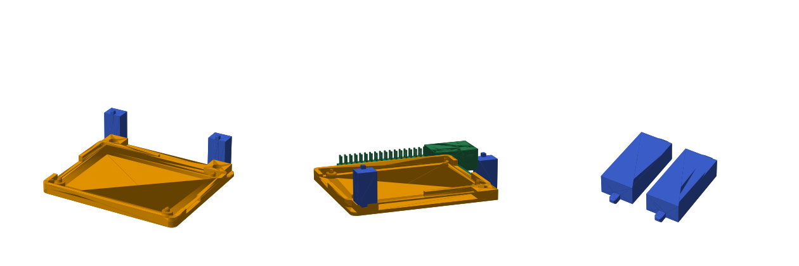

# prints

3D-printable parts for the Bambu Lab A1 (PLA), modelled in CadQuery.

| Part | What | Files |
|---|---|---|
| `ac164162/` | Open-top tray for the Microchip AC164162 Curiosity Nano Base for Click boards (74.93 x 107.95 mm, 6x M2.5 from the official drawing). 3.5 mm standoffs, USB/switch edge left open, slot in the right wall for the right-angle Xplained Pro header. 32 min, 24 g. | `tray.py`, `out/tray.stl`, `out/tray.gcode.3mf` |
| `ac164162/` snap | Screwless Pi-case style version: pins on the corner standoffs + four flex clips over the PCB edge. 35 min, 24 g. | `out/tray_snap.stl`, `out/tray_snap.gcode.3mf` |

Model: `uv run --with cadquery python ac164162/tray.py`
Slice for the A1 (Bambu Studio in an x86 Linux container): `bambu-cli/slice.sh ac164162/out/tray.gcode.3mf ac164162/out/tray.stl`
Print: copy the `.gcode.3mf` into the SD card's `model/` folder and pick it on the printer.

What to print next: [QUEUE.md](QUEUE.md).

First print (8 mm standoffs) sat too high; lowered to 3.5 mm, not re-fitted yet.

## a1-cable-holder
Bambu Lab A1 cable holder by its MakerWorld author (model 119194, CC BY-NC). It snaps onto the A1 above the X axis.
https://makerworld.com/en/models/119194
The STL comes from the public preview mesh. It is sliced to match the author's profile: 3 walls, 15% infill, no supports. It takes about 39 minutes and 16 g.

## t-eth-elite
Open-top tray for the LILYGO T-ETH Elite (ESP32-S3 + W5500 + PoE) with a Pi HAT stacked on its GPIO header. The board geometry comes from LILYGO's official 3D model. The RJ45, USB-C, BOOT/RST buttons and microSD slot are all left open.

- **Print: `out/kit.gcode.3mf`**, about 25 minutes and 15 g. It is the clip-free tray plus two 19.5 mm square pillars on one plate.
- **Tray, `out/tray_pins.stl`:** the board drops onto 4 corner pins on 3 mm standoffs. The base is one solid rectangle.
- **Pillars, `out/pillars.stl`:** they plug into the tray's two sockets past the button edge, and their square pins go into the HAT's far holes. They print lying flat.
- `out/tray.stl` is the same tray for M2.5 self-tapping screws instead of pins.

History: two prints came loose. One was a Pi-shaped frame with round pins, the other had round bosses sticking out past the tray. Every part now sits on a full flat face.

## jetson-nano/

Open-top tray for the Jetson Nano Developer Kit (B01/A02 carrier, 100 x 80 mm), heatsink + fan left on.
The board drops onto four square pegs in its 3 mm corner holes (86 x 58 mm pattern, no screws); walls stop
just under the PCB top, floor slots under the board. `out/tray.stl`, `out/tray.gcode.3mf` (40 min, 26 g).

`case.py`: the closed three-part version, 106 x 86 x 55 mm, R10 corners, with the Arducam B0179 (IMX219)
looking out of the front above the ports. Base = low tray with a solid floor; frame = the walls, every
opening a notch from its bottom edge and printed upside down, so no bridges anywhere; camera rails inside
the front wall (the board slides in by its edges); top = flat plate with the fan grille, printed face-down
(try a second colour). Pegs, no screws. `FAN_TOP` is an estimate (38 mm) but the camera already gives the
fan 6 mm of room. `out/case.gcode.3mf` = all three, 2 h 36 m, 81 g.
