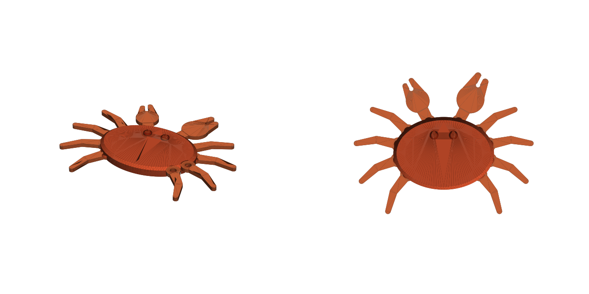

# 관절 킹크랩 (장난감)

[crab_toy.py](crab_toy.py) (CadQuery). **한 번에 통째로 출력**, 다리 8개·집게 2개가 이미 관절로 연결돼 나옴. 나사·베어링·스냅·조립 없음.
PLA, 0.2 mm, 벽 3겹, 브림·서포트 없음: `crab.gcode.3mf` (1 h 23 m / 43 g). 168 × 133 × 15 mm.

- **움직임:** 다리·집게가 바닥면 안에서 좌우로 돈다(포즈 잡기).
- **쓸모:** 집게 사이 홈(Ø4.2, 입구 3.2)에 USB 선이 딸깍 들어감 → 책상 선 정리. 오른쪽 집게가 더 큼(진짜 킹크랩처럼).
- **관절:** 몸통에서 바닥부터 올라온 기둥이 다리 고리를 지나 위에서 몸통과 붙음(고리 위 0.4 mm에 몸통이 다리처럼 걸침 → 다리가 위로 안 빠짐). 기둥 아래 45° 턱 + 고리 안쪽 45° 경사 → 들어 올려도 다리가 아래로 안 빠짐.
- **틈:** 가로 0.5 mm, 첫 층 0.9 mm(기둥 발 모서리 깎음). 다리끼리 0.8 mm 이상, 다리–몸통 0.5 mm 이상 (코드에서 검사).
- **뽑은 뒤:** 판이 식으면 떼고, 다리를 하나씩 살살 앞뒤로 꺾어서 관절을 풀어 줌.
