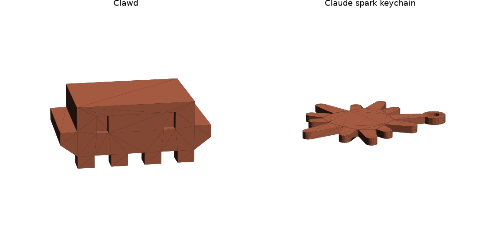

# Claude 장난감

[claude_toys.py](claude_toys.py) (CadQuery). 주황 PLA, 0.2 mm, 벽 3겹, 브림·서포트 없음. 두 개가 한 판: `claude_toys.gcode.3mf` (49분 / 21 g).

| 파일 | 뭔지 | 크기 |
|---|---|---|
| `clawd.stl` | Clawd (Claude Code 픽셀 마스코트). 6 mm 픽셀, 눈은 3 mm 홈(검은 마커로 칠하면 됨), 팔 아래는 45° 경사라 서포트 없이 뽑힘. 다리가 앞뒤로 4개씩 8개 — 작은 킹크랩 | 54 × 30 × 30 |
| `spark.stl` | Claude 반짝이(별 모양) 키링, 두께 4 mm, 고리 Ø4.8 | 64 × 52 × 4 |

다리 8개(각 6 × 6 mm)로 바닥에 서서 뽑힌다. 판에서 뗄 때 다리를 옆으로 비틀지 말고 스크레이퍼로.
