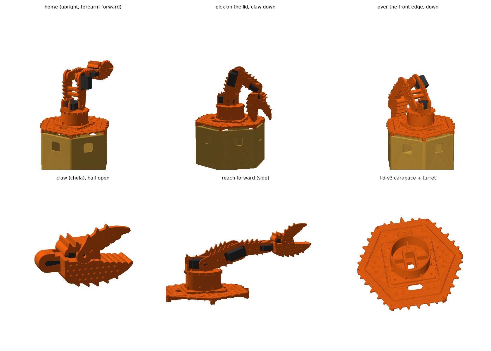
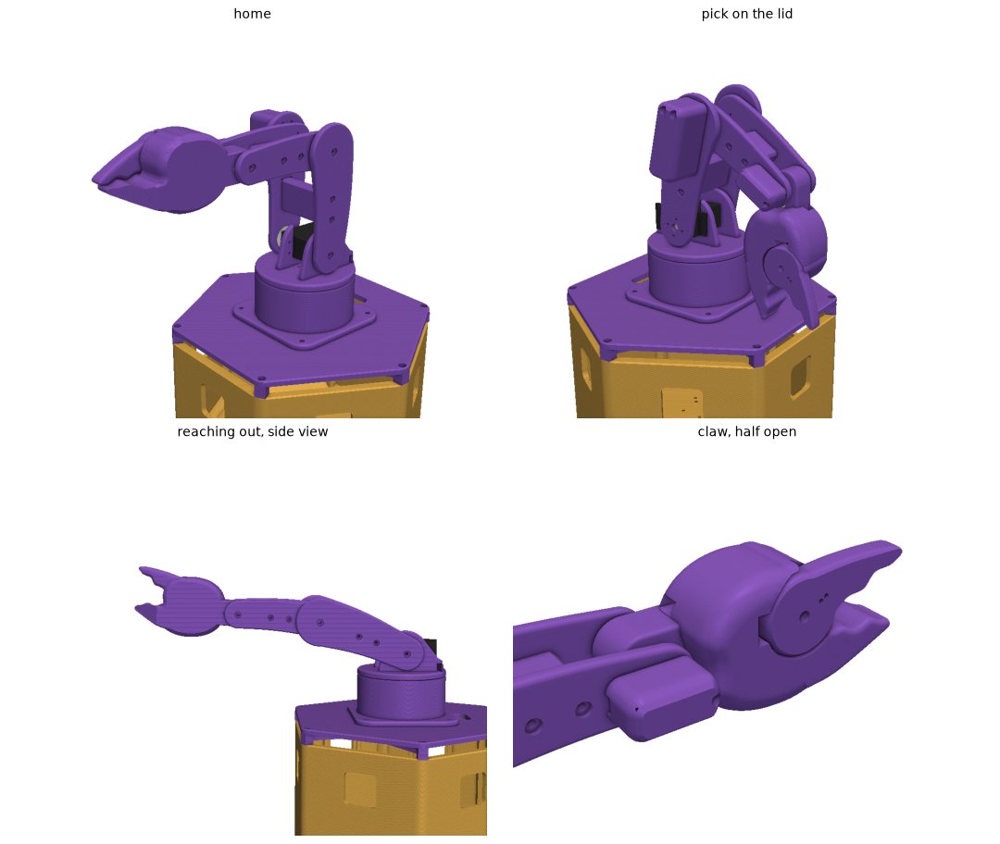

# 킹크랩 팔 (King Crab arm)

센서 박스 뚜껑 [lid-v3](../sensor-box/lid-v3/) 위에 올리는 게 집게발 로봇팔. 서보는 이미 산 것만 씀: **MG996R 3개 + MG90S 2개** (MG996R 1개, MG90S 2개는 예비).
코드: [crab.py](crab.py) (CadQuery). 출력물은 전부 이 폴더에 있음. 주황 PLA, 0.2 mm, 벽 3겹, 브림 없음, 서포트 없음.

## 2026-11-02 정리

- 가시·돌기를 붙인 "킹크랩 모양" 버전(3ea479c)은 별로라서 되돌림. 팔은 그 전의 매끈한 판 버전(이 폴더의 STL/gcode)을 씀.
- 뚜껑은 가시와 글자를 뺀 매끈한 [lid-v4-clean](../sensor-box/lid-v4-clean/) (`ARM=crab python sensor-box/lid.py`). 터렛 M4 (±40), 몸통 M3 기둥, 배기 간격은 v3와 같아서 이 팔이 그대로 올라감. 2026-11-02 출력함 (3 h 31 m / 142 g).
- 재설계 조사: [DESIGN_RESEARCH.md](DESIGN_RESEARCH.md). `crab_lightening_experiment.py`, `rev2/`는 가시 버전 위에 만든 경량화 실험안(관통창). 슬라이서 기준 2.5 % 가볍고 9분 더 걸려서 **출력 추천본 아님**, 강도·조립 미검증.

## v2 (깔끔한 킹크랩) — `v2/`, [crab_v2.py](crab_v2.py)

가시·돌기 없이 실루엣과 곡면으로만 킹크랩 느낌을 낸 새 디자인. **보라색 PLA 단색**을 기준으로 만듦(색 포인트 없음, 미리보기도 보라색).
서보·혼·관절 축·x 적층·링크 길이(90/80)·터렛 M4 플랜지(±40)는 v1과 같고, 서보/혼 치수는 `crab.py`의 `S`/`M`을 그대로 가져다 씀(시험판으로 고치면 v1·v2 둘 다 따라감).
v1 파일(이 폴더의 STL/gcode)은 그대로 둠.

- 윗팔(merus)·아래팔(carpus): 관절 쪽이 둥글고 가운데가 살짝 휜 테이퍼 판. 모서리는 전부 둥글게(바닥면은 45°로 시작하는 둥근 모서리라 서포트 없음).
- 사각 스페이서 2개 대신 링크마다 모따기한 막대(web) 1개. 나사머리는 바깥판의 카운터보어 안으로, 축 나사도 카운터보어.
- **서보 덮개**: J3 MG996R(윗팔)·J4 MG90S(아래팔) 위에 매끈한 덮개. 따로 나사 없이 서보 귀 나사(스플라인 쪽)로 덮개째 눌러 고정 → 링크가 통짜 다리 마디처럼 보임. 반대쪽 귀 나사는 먼저 조이고 덮개 열린 끝으로 선이 나옴.
- 집게(chela): 볼록한 큰 손바닥, 둥근 뿌리를 가진 움직이는 손가락(dactylus, J5 축을 44→58 mm로 앞으로 옮김)과 고정 손가락(pollex)이 한 줄의 완만한 물결선(손가락마다 넓은 혹 2개, 엇갈림)에서 만남. 고정 손가락은 아래쪽 45° 경사로 12 mm까지 얇아져 움직이는 손가락(12 mm)과 두께가 같음. J5 선은 손바닥 안 터널로 뒤로 빠짐(윗면 홈 없음).
- 터렛: 모서리 R16 둥근 사각 플랜지 + 원통. 턴테이블: 둥근 원판 + J2 축을 감싸는 D자 받침.

확인(crab_v2.py): 12개 부품 모두 watertight·한 덩어리, 베드 240 mm 안, 바닥면 전체 접촉, 7개 자세에서 서보 더미 + lid-v4-clean과 충돌 0.
45° 넘는 아래 면은 브리지뿐(턴테이블 J1 혼 포켓은 v1과 같음, 카운터보어 천장, J5 선 터널 7 mm).
토크(수평 최대, 50 g): 움직이는 질량 301 g, J2 4.63 kg·cm = 정지토크의 **51 %**, J3 24 %, J4 45 %.

| 파일 (`v2/`) | 내용 | 시간 / g |
|---|---|---|
| `turret.gcode.3mf` | 터렛 | 1 h 52 m / 81 g |
| `turntable.gcode.3mf` | 턴테이블 + 어깨 받침 | 1 h 04 m / 31 g |
| `upper_arm.gcode.3mf` | 윗팔 Q, Q' + 막대 + J3 덮개 | 1 h 44 m / 55 g |
| `forearm_dactyl.gcode.3mf` | 아래팔 F, F' + 막대 + J4 덮개 + 움직이는 손가락 | 1 h 21 m / 40 g |
| `claw.gcode.3mf` | 집게 몸통 + 고정 손가락 | 1 h 22 m / 50 g |
| | 합계 (판 5장) | **7 h 24 m / 257 g** (v1 6 h 30 m / 232 g) |
| `arm_all.gcode.3mf` | 12개 부품 한 판 | 6 h 29 m / 256 g |

v1과 다른 나사: 막대 M3 × 12 8개(스페이서 자리), J3 덮개 M3 × 16 2개(J3 스플라인 쪽 귀), J4 덮개 M2 × 14 1개(J4 스플라인 쪽 귀).
축 나사는 v1과 같음(카운터보어 2 mm 안에 머리+와셔). 실물 조립은 아직 안 해봄.

### 2026-11-04 나사 구멍 뜸 수정

바닥에 닿는 면의 카운터보어(나사머리 자리)는 천장이 구멍 둘레 고리 모양으로 허공에 떠서 출력이 지저분했음.
이제 천장을 계단식 브리지로 바꿈: 0.2 mm 한 층은 구멍 폭의 슬롯이 카운터보어를 가로지르고(양쪽 테두리에 걸침), 다음 층은 구멍 크기 사각, 그다음 원형 구멍.
대상: 윗팔 Q·Q', 아래팔 F' (막대·축 나사 자리). `upper_arm`, `forearm_dactyl`, `arm_all` 다시 슬라이스(시간·무게 거의 같음). 조립 순서: [v2/assembly.png](v2/assembly.png).
같은 수정을 뚜껑 모서리 M3 카운터보어에도 넣음(`sensor-box/lid.py`, lid-v4-clean, lid-lidar).

### 서보 없이 조립 (더미)

서보가 오기 전에 손으로 조립해서 자세를 잡아볼 수 있는 출력 더미. `v2/dummy_j1~j5.stl`(서보 외형: 몸통·귀, 귀 나사 구멍 같은 자리) + `v2/hub_j1~j5.stl`(혼 대신 링크의 혼 포켓에 들어가는 허브, 혼 나사가 그대로 박힘).
진짜 서보와 같은 창/포켓에 같은 귀 나사로 고정됨(외형이 서보보다 큰 곳은 케이스 윗면 위 보스의 각진 모서리뿐, 케이스 발자국 안).
축은 스플라인 자리의 나사 하나: 허브를 더미 보스에 눌러 붙이는 구조라 **조이는 만큼 뻑뻑해짐 → 손으로 돌렸을 때 자세가 유지될 만큼 조일 것**.

| 관절 | 축 나사 |
|---|---|
| J1·J2·J3 | M3 × 16, 링크 쪽에서 혼 가운데 구멍(Ø7)으로 넣어 허브(Ø3.4 통과) → 더미 보스의 Ø2.6 구멍에 셀프태핑 |
| J5 | M2 × 12, 손가락 가운데 구멍(Ø5)으로 → 더미의 Ø1.7 구멍 |
| J4 | 집게 쪽 가운데가 막혀 있어서 반대로: M3 × 30 + 와셔, 더미 바닥 카운터보어에서 통과 구멍(Ø3.4)으로 → 허브 Ø2.6에 셀프태핑 (J4 덮개 씌우기 전에) |

출력: `v2/dummies.gcode.3mf` 더미 5 + 허브 5 한 판 **1 h 44 m / 52 g** (더미는 옆으로 눕혀서, 허브는 혼 면이 바닥).
팔 12개와 더미 10개는 한 판에 안 들어가서(A1 자동 배치가 2판으로 나눔) 팔은 `v2/arm_all.gcode.3mf`(6 h 29 m / 256 g), 더미는 따로.
확인: 더미·허브 모두 watertight·한 덩어리, 7개 자세에서 더미를 넣은 상태로 충돌 0.

## 구조

| 관절 | 서보 | 어떻게 |
|---|---|---|
| J1 베이스 회전 | MG996R | 터렛(뚜껑에 M4 4개) 안에 세워 넣고 귀를 터렛 윗면에 M3로 고정. 턴테이블이 혼에 붙고, 터렛 바깥 링(0.5 mm 아래)이 기울어지는 하중을 받음 |
| J2 어깨 | MG996R | 턴테이블 위 받침(A판: 위가 열린 홈에 서보를 내려 넣고 귀를 M3로, B판: 반대쪽 축 M3) |
| J3 팔꿈치 | MG996R | 윗팔 바깥판(Q)에 귀를 대고 스플라인은 안쪽. 아래팔이 그 혼에 붙고 반대쪽은 M3 축 |
| J4 손목(상하) | MG90S | 아래팔 바깥판(F)에 귀, 스플라인 안쪽. 집게 관절부(knuckle)가 혼에 붙고 반대쪽 M3 축 |
| J5 집게 | MG90S | 집게 몸통(propodus) 안에 눕혀 넣음. 움직이는 손가락(dactylus)이 혼에 붙어 몸통 윗면 홈 안에서 0~45° 열림. 고정 손가락(pollex)과 톱니가 한 평면에서 맞물림 |

- 팔은 판 두 장 + 사각 스페이서 2개(M3 셀프태핑) 구조라 모든 판이 바닥에 통째로 붙어서 출력됨. 위쪽 모서리의 가시, 집게 톱니가 킹크랩 모양.
- 길이: J2–J3 90 mm, J3–J4 80 mm, J4–집게 끝 108 mm. 집게 폭 41 mm, 몸통 두께가 그대로 집게 두께(뭉툭한 킹크랩 집게).
- 이음새는 전부 나사. 스냅 없음.

## 토크 확인 (팔을 수평으로 끝까지 뻗고 집게에 50 g 쥔 최악 자세)

움직이는 질량 275 g(슬라이서 g 기준 출력물 + 서보 + 나사 + 50 g).

| 관절 | 필요 | 서보 정지토크(4.8 V) | 비율 |
|---|---|---|---|
| J2 어깨 MG996R | 4.3 kg·cm | 9 | 47 % (6 V에서 ~11 kg·cm면 39 %) |
| J3 팔꿈치 MG996R | 2.0 kg·cm | 9 | 22 % |
| J4 손목 MG90S | 0.8 kg·cm | 1.8 | 43 % |
| J5 집게 MG90S | 손끝 쥐는 힘 ~0.3 kgf (힌지에서 ~55 mm) | 1.8 | |

수평으로 다 뻗은 상태에서 오래 버티지 말 것(어깨가 정지토크의 절반 가까이). 평소 자세는 `home`(윗팔 세우고 아래팔 앞으로).

## 확인한 것 (crab.py)

- 모든 부품 watertight, 베드 240 mm 안, 바닥면 전체 접촉.
- 7개 자세에서 팔 부품 + 서보 더미(케이스, 귀, 출력축, 혼) + 뚜껑끼리 충돌 0: home, 앞으로 뻗기, 뚜껑 위 집기(집게 아래로, 끝 z 4 mm), 앞쪽 모서리 너머 아래로, 접기, 옆으로 낮게(yaw 90°), 위로.
  권장 소프트웨어 범위: J2 15~115°, J3 -145~-15°, J4 -60~+80°, J5 0(닫힘)~45°(열림).
- lid-v3 (`ARM=crab python sensor-box/lid.py`): 터렛 플랜지 볼트 구멍 4개 정렬, 터렛과 뚜껑 겹침 없음, 뚜껑 가장자리 안, 케이블 슬롯이 터렛 밖, 몸통 기둥 위 기둥 6개 OK.

## 출력 (A1, PLA 220 °C, `SET="wall_loops=3 brim_type=no_brim"`)

| 순서 | 파일 | 내용 | 시간 / g |
|---|---|---|---|
| 0 | `coupon.gcode.3mf` | **먼저 출력: 맞춤 시험판** (MG996R·MG90S 귀 프레임 + 두 혼 포켓) | 26 m / 8.4 g |
| 1 | `../sensor-box/lid-v3/lid.gcode.3mf` | 뚜껑 v3 (윗면 아래로) | 3 h 00 m / 133 g |
| 2 | `turret.gcode.3mf` | 터렛 (J1) | 1 h 51 m / 82 g |
| 3 | `turntable.gcode.3mf` | 턴테이블 + 어깨 받침 (원판 아래 혼 포켓은 브리지로 출력) | 1 h 04 m / 33 g |
| 4 | `upper_arm.gcode.3mf` | 윗팔 Q, Q' + 스페이서 2 | 1 h 08 m / 37 g |
| 5 | `forearm_dactyl.gcode.3mf` | 아래팔 F, F' + 스페이서 2 + 움직이는 손가락 | 1 h 03 m / 31 g |
| 6 | `claw.gcode.3mf` | 집게 몸통 + 고정 손가락 | 1 h 24 m / 49 g |
| | | 팔 합계 (2~6) | **6 h 30 m / 232 g** |

STL도 같이 있음 (출력 방향으로 놓여 있음).

## 맞춤 시험판으로 확인할 것 (치수는 실측 아님!)

서보와 혼 치수는 판매처 도면/일반값이라 **실물 측정 필요**. 시험판으로:
1. MG996R 케이스가 창에 들어가고(0.25 mm 여유) 귀 구멍 4개가 파일럿 위에 오는지 (49.5 × 10 가정). MG90S도 (27.8 가정).
2. 원형 혼(Ø21 × 2.5 가정, 나사 구멍 반지름 7.5 가정)이 포켓에 평평하게 들어가 0.3 mm 튀어나오는지, 구멍이 맞는지.
3. MG90S 한쪽 팔 혼(허브 Ø7, 끝 Ø4, 길이 15, 두께 1.6 가정, 구멍 9·12 mm 가정).
4. 캘리퍼로: 귀 아랫면 → 혼 윗면 높이 (MG996R 17.9, MG90S 18.1 가정), 귀 아랫면 → 케이스 바닥 (26.6 / 15.9), 스플라인 축 → 케이스 앞끝 (10.0 / 5.9), 귀 두께 (2.5).
다르면 crab.py 맨 위 `S`/`M` 딕셔너리 숫자만 바꾸고 다시 돌리면 모든 부품과 충돌 검사가 따라옴.

## 사야 할 것

| 품목 | 수량 | 용도 |
|---|---|---|
| PCA9685 16채널 서보 드라이버 (I2C) | 1 | AGX 40핀 헤더 I2C(3/5번 핀)에 연결 |
| 6 V 서보 전원, **5 A 이상** (UBEC/BEC, 10 A면 여유) | 1 | MG996R 정지 전류 ~2.5 A씩. PCA9685 V+ 단자로, AGX와 GND 공통 |
| 서보 연장선 30 cm | 3~5 | J3~J5 |
| M4 × 20 + M4 너트 | 4 | 터렛 → 뚜껑 (너트는 뚜껑 아래 육각 홈) |
| M3 × 8 셀프태핑 + 와셔 | 12 | MG996R 귀 (J1, J2, J3) |
| M3 × 12 (셀프태핑 또는 기계나사) | 10 | 스페이서 8, J2·J3 축 2 |
| M3 × 16 | 1 | J4 축 |
| M3 와셔(또는 1 mm 나일론 와셔) | 3 | 축마다 판 사이 1 mm 간격 |
| M2 × 8 셀프태핑 | 8 | MG90S 귀 4, MG90S 혼 4 |
| M2 × 10 셀프태핑 (또는 M2.5) | 11 | MG996R 원형 혼 (J1 3개, J2·J3 4개씩) |
| M3 × 20 셀프태핑 | 6 | 뚜껑 → 몸통 기둥 (v1/v2와 같음) |

## 조립 순서 (요점)

1. 터렛을 뚜껑에(M4), J1 서보를 터렛에, J1 선은 터렛 아래 뚜껑 구멍으로.
2. J1 혼을 서보에 + 가운데 나사 → 턴테이블을 위에서 혼 나사 3개로 (J2 서보 넣기 전에).
3. J2 서보를 A판 홈에 위에서 내려 넣고 귀 M3. 윗팔 Q를 J2 혼에(바깥에서 혼 나사 4개, 가운데 나사는 Q의 Ø7 구멍으로).
4. J3 서보를 Q 바깥에서 끼우고 귀 M3. 아래팔 F를 J3 혼에 → F 스페이서 → 집게를 J4 혼에(관절부 아래 카운터보어에서 M2) → F'(J4 축 M3 × 16) → 윗팔 스페이서 → Q'(J2·J3 축 M3 × 12). 축 나사는 판이 부드럽게 돌 만큼만 조임.
5. J5 서보를 집게 몸통에, 손가락을 혼에(위에서 M2 2개 + 가운데 Ø5 구멍).
6. 서보 중립(1500 µs)에서 혼을 끼울 것: J2 90°(윗팔 세움), J3 -90°(아래팔 앞), J4 0, J5 닫힘.

## 메모

- 축은 M3 나사가 바깥판 3.4 구멍에서 도는 방식(베어링 없음). 장난감/데모 하중용.
- AGX 열은 뚜껑 10 mm 틈으로 빠짐. 터렛 아래 J1 선 구멍(14 × 26)도 뚜껑에 있음.
- PETG가 더 낫다면 같은 파일로 출력 가능(뚜껑 근처 열).
