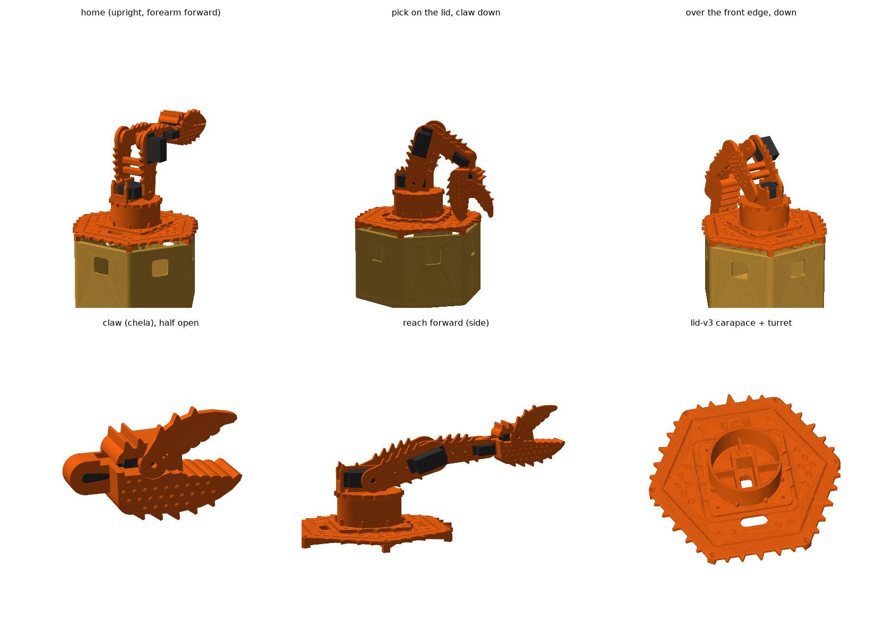

# 킹크랩 팔 (King Crab arm)

센서 박스 뚜껑 [lid-v3](../sensor-box/lid-v3/) 위에 올리는 게 집게발 로봇팔. 서보는 이미 산 것만 씀: **MG996R 3개 + MG90S 2개** (MG996R 1개, MG90S 2개는 예비).
코드: [crab.py](crab.py) (CadQuery). 출력물은 전부 이 폴더에 있음. 주황 PLA, 0.2 mm, 벽 3겹, 브림 없음, 서포트 없음.

## 구조

| 관절 | 서보 | 어떻게 |
|---|---|---|
| J1 베이스 회전 | MG996R | 터렛(뚜껑에 M4 4개) 안에 세워 넣고 귀를 터렛 윗면에 M3로 고정. 턴테이블이 혼에 붙고, 터렛 바깥 링(0.5 mm 아래)이 기울어지는 하중을 받음 |
| J2 어깨 | MG996R | 턴테이블 위 받침(A판: 위가 열린 홈에 서보를 내려 넣고 귀를 M3로, B판: 반대쪽 축 M3) |
| J3 팔꿈치 | MG996R | 윗팔 바깥판(Q)에 귀를 대고 스플라인은 안쪽. 아래팔이 그 혼에 붙고 반대쪽은 M3 축 |
| J4 손목(상하) | MG90S | 아래팔 바깥판(F)에 귀, 스플라인 안쪽. 집게 관절부(knuckle)가 혼에 붙고 반대쪽 M3 축 |
| J5 집게 | MG90S | 집게 몸통(propodus) 안에 눕혀 넣음. 움직이는 손가락(dactylus)이 혼에 붙어 몸통 윗면 홈 안에서 0~45° 열림. 고정 손가락(pollex)과 톱니가 한 평면에서 맞물림 |

- 팔은 판 두 장 + 사각 스페이서 2개(M3 셀프태핑) 구조라 모든 판이 바닥에 통째로 붙어서 출력됨.
- 이음새는 전부 나사. 스냅 없음.

## 킹크랩 모양 (Paralithodes)

장식만 바꿨고 서보 포켓, 혼, 축 구멍, 나사 위치, 링크 길이(90 / 80), 터렛 플랜지 M4, 뚜껑 기둥, 맞춤 시험판은 전과 똑같음.

- **가시**: 전부 판 외곽선에 들어간 2D 삼각 가시(끝 1.6 mm 평평)라 바닥에 붙은 채 그대로 출력됨. 윗팔(장절, merus)은 위 모서리에 큰 가시 5개 + 아래 3개, 아래팔(완절, carpus)은 위 4개 + 아래 2개, 모두 집게 쪽으로 기울어짐. 턴테이블 원판 테두리 18개, 터렛 링 아래쪽 둘레 낮은 능선 8개(14 mm, 링 전체 높이로 하면 출력 45분 늘어서), 터렛 플랜지 좌·우·앞 가시(뒤는 케이블 슬롯 때문에 곧게), 어깨 받침판 위 가시.
- **돌기(혹)**: 출력할 때 위를 보는 면에만 뭉툭한 원뿔(높이 1.8 mm, 끝 Ø2): 윗팔 Q' 바깥면 18개, 아래팔 F 면 6개, 집게 몸통 윗면 25개. 나사 머리 자리는 비워 둠.
- **집게(chela)**: 불룩하고 무거운 손바닥(propodus), 끝이 위로 휘는 두꺼운 고정 손가락, 등이 굽고 가시 3개에 끝이 갈고리처럼 내려오는 움직이는 손가락, 톱니 대신 둥근 어금니(부수는 이빨) 5개씩. 손바닥 위·아래 모서리에도 가시.
- **뚜껑 lid-v3 = 등딱지**: 육각 여섯 변에 가시 5개씩(앞쪽 가운데는 13 mm 이마뿔), 윗면(베드에 닿는 면)은 이름과 같은 0.6 mm 음각만: 가장자리 홈, 터렛 둘레 홈, 그 사이 고리 모양 혹 무늬. 모서리·기둥·구멍은 그대로.
- 길이: J2–J3 90 mm, J3–J4 80 mm, J4–집게 끝 108 mm. 집게 두께 41 mm(돌기까지 43), 몸통 두께가 그대로 집게 두께(뭉툭한 킹크랩 집게).
## 토크 확인 (팔을 수평으로 끝까지 뻗고 집게에 50 g 쥔 최악 자세)

움직이는 질량 288 g(슬라이서 g 기준 출력물 + 서보 + 나사 + 50 g).

| 관절 | 필요 | 서보 정지토크(4.8 V) | 비율 |
|---|---|---|---|
| J2 어깨 MG996R | 4.6 kg·cm | 9 | 51 % (6 V에서 ~11 kg·cm면 41 %) |
| J3 팔꿈치 MG996R | 2.2 kg·cm | 9 | 24 % |
| J4 손목 MG90S | 0.8 kg·cm | 1.8 | 47 % |
| J5 집게 MG90S | 손끝 쥐는 힘 ~0.3 kgf (힌지에서 ~55 mm) | 1.8 | |

수평으로 다 뻗은 상태에서 오래 버티지 말 것(어깨가 정지토크의 절반쯤). 평소 자세는 `home`(윗팔 세우고 아래팔 앞으로).

## 확인한 것 (crab.py)

- 모든 부품 watertight, 베드 240 mm 안, 바닥면 전체 접촉.
- 7개 자세에서 팔 부품 + 서보 더미(케이스, 귀, 출력축, 혼) + 뚜껑(등딱지 가시 포함)끼리 충돌 0: home, 앞으로 뻗기, 뚜껑 위 집기(집게 아래로, 끝 z 4 mm), 앞쪽 모서리 너머 아래로, 접기, 옆으로 낮게(yaw 90°), 위로.
  권장 소프트웨어 범위: J2 15~115°, J3 -145~-15°, J4 -60~+80°, J5 0(닫힘)~45°(열림).
- lid-v3 (`ARM=crab python sensor-box/lid.py`): 터렛 플랜지 볼트 구멍 4개 정렬, 터렛과 뚜껑 겹침 없음, 뚜껑 가장자리 안, 케이블 슬롯이 터렛 밖, 몸통 기둥 위 기둥 6개 OK. 가시 포함 236 × 230 mm(베드 240 안).
- 어깨 받침판 가시는 윗팔 스페이서가 어깨 범위(15~115°)에서 쓸고 지나가는 J2 반지름 24~40 mm 고리 밖에 둠.

## 출력 (A1, PLA 220 °C, `SET="wall_loops=3 brim_type=no_brim"`)

| 순서 | 파일 | 내용 | 시간 / g |
|---|---|---|---|
| 0 | `coupon.gcode.3mf` | **먼저 출력: 맞춤 시험판** (MG996R·MG90S 귀 프레임 + 두 혼 포켓) | 26 m / 8.4 g |
| 1 | `../sensor-box/lid-v3/lid.gcode.3mf` | 뚜껑 v3 등딱지 (윗면 아래로) | 3 h 31 m / 138 g |
| 2 | `turret.gcode.3mf` | 터렛 (J1) | 1 h 59 m / 84 g |
| 3 | `turntable.gcode.3mf` | 턴테이블 + 어깨 받침 (원판 아래 혼 포켓은 브리지로 출력) | 1 h 14 m / 35 g |
| 4 | `upper_arm.gcode.3mf` | 윗팔 Q, Q' + 스페이서 2 | 1 h 15 m / 39 g |
| 5 | `forearm_dactyl.gcode.3mf` | 아래팔 F, F' + 스페이서 2 + 움직이는 손가락 | 1 h 09 m / 33 g |
| 6 | `claw.gcode.3mf` | 집게 몸통 + 고정 손가락 | 1 h 51 m / 58 g |
| | | 팔 합계 (2~6) | **7 h 28 m / 249 g** (킹크랩 장식 전 6 h 30 m / 232 g) |

STL도 같이 있음 (출력 방향으로 놓여 있음).

## 맞춤 시험판으로 확인할 것 (치수는 실측 아님!)

서보와 혼 치수는 판매처 도면/일반값이라 **실물 측정 필요**. 시험판으로:
1. MG996R 케이스가 창에 들어가고(0.25 mm 여유) 귀 구멍 4개가 파일럿 위에 오는지 (49.5 × 10 가정). MG90S도 (27.8 가정).
2. 원형 혼(Ø21 × 2.5 가정, 나사 구멍 반지름 7.5 가정)이 포켓에 평평하게 들어가 0.3 mm 튀어나오는지, 구멍이 맞는지.
3. MG90S 한쪽 팔 혼(허브 Ø7, 끝 Ø4, 길이 15, 두께 1.6 가정, 구멍 9·12 mm 가정).
4. 캘리퍼로: 귀 아랫면 → 혼 윗면 높이 (MG996R 17.9, MG90S 18.1 가정), 귀 아랫면 → 케이스 바닥 (26.6 / 15.9), 스플라인 축 → 케이스 앞끝 (10.0 / 5.9), 귀 두께 (2.5).
다르면 crab.py 맨 위 `S`/`M` 딕셔너리 숫자만 바꾸고 다시 돌리면 모든 부품과 충돌 검사가 따라옴.

## 사야 할 것

| 품목 | 수량 | 용도 |
|---|---|---|
| PCA9685 16채널 서보 드라이버 (I2C) | 1 | AGX 40핀 헤더 I2C(3/5번 핀)에 연결 |
| 6 V 서보 전원, **5 A 이상** (UBEC/BEC, 10 A면 여유) | 1 | MG996R 정지 전류 ~2.5 A씩. PCA9685 V+ 단자로, AGX와 GND 공통 |
| 서보 연장선 30 cm | 3~5 | J3~J5 |
| M4 × 20 + M4 너트 | 4 | 터렛 → 뚜껑 (너트는 뚜껑 아래 육각 홈) |
| M3 × 8 셀프태핑 + 와셔 | 12 | MG996R 귀 (J1, J2, J3) |
| M3 × 12 (셀프태핑 또는 기계나사) | 10 | 스페이서 8, J2·J3 축 2 |
| M3 × 16 | 1 | J4 축 |
| M3 와셔(또는 1 mm 나일론 와셔) | 3 | 축마다 판 사이 1 mm 간격 |
| M2 × 8 셀프태핑 | 8 | MG90S 귀 4, MG90S 혼 4 |
| M2 × 10 셀프태핑 (또는 M2.5) | 11 | MG996R 원형 혼 (J1 3개, J2·J3 4개씩) |
| M3 × 20 셀프태핑 | 6 | 뚜껑 → 몸통 기둥 (v1/v2와 같음) |

## 조립 순서 (요점)

1. 터렛을 뚜껑에(M4), J1 서보를 터렛에, J1 선은 터렛 아래 뚜껑 구멍으로.
2. J1 혼을 서보에 + 가운데 나사 → 턴테이블을 위에서 혼 나사 3개로 (J2 서보 넣기 전에).
3. J2 서보를 A판 홈에 위에서 내려 넣고 귀 M3. 윗팔 Q를 J2 혼에(바깥에서 혼 나사 4개, 가운데 나사는 Q의 Ø7 구멍으로).
4. J3 서보를 Q 바깥에서 끼우고 귀 M3. 아래팔 F를 J3 혼에 → F 스페이서 → 집게를 J4 혼에(관절부 아래 카운터보어에서 M2) → F'(J4 축 M3 × 16) → 윗팔 스페이서 → Q'(J2·J3 축 M3 × 12). 축 나사는 판이 부드럽게 돌 만큼만 조임.
5. J5 서보를 집게 몸통에, 손가락을 혼에(위에서 M2 2개 + 가운데 Ø5 구멍).
6. 서보 중립(1500 µs)에서 혼을 끼울 것: J2 90°(윗팔 세움), J3 -90°(아래팔 앞), J4 0, J5 닫힘.

## 메모

- 축은 M3 나사가 바깥판 3.4 구멍에서 도는 방식(베어링 없음). 장난감/데모 하중용.
- AGX 열은 뚜껑 10 mm 틈으로 빠짐. 터렛 아래 J1 선 구멍(14 × 26)도 뚜껑에 있음.
- PETG가 더 낫다면 같은 파일로 출력 가능(뚜껑 근처 열).
