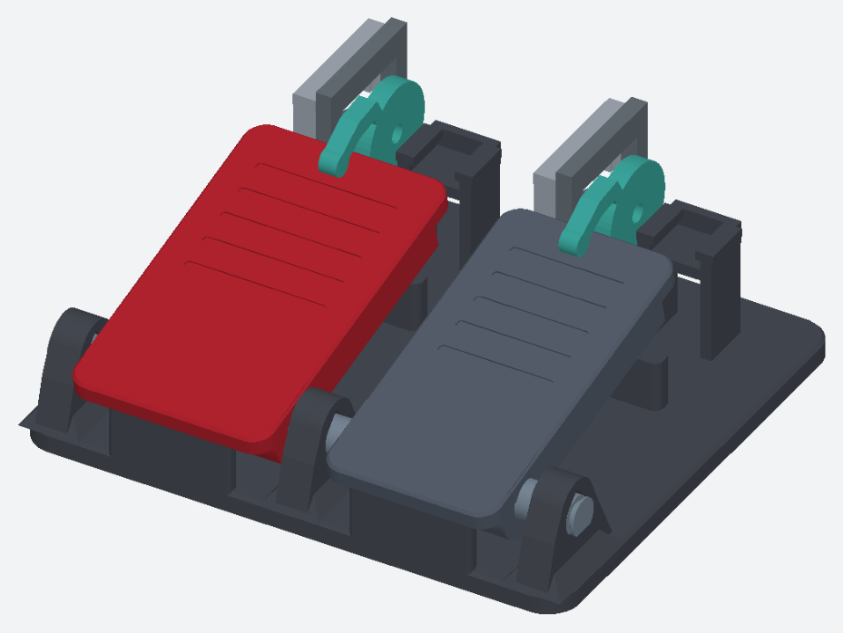

# PETG 2페달 · MG996R 단방향 캠 시제품

공용 베이스와 PETG 관통축을 쓰는 두 페달이다. 각 채널에 MG996R 하나, 순정 6발 혼과 순정 중앙 나사만 사용한다. 캠, 슬라이드 고정부, 고정 클립, 교체식 복귀 판스프링은 출력한다. 새 금속 볼트·베어링·와이어·기어는 부품표에 없다. 서보를 구동하는 기존 제어기와 전원은 별도다.

## A1 출력과 조립

1. F판으로 혼을 먼저 확인한다. 포켓 여유는 슬라이서 표준 정방향으로 놓았을 때 모델 좌표 왼쪽부터 편측 0.20, 0.30, 0.40 mm다. 현행 캠은 0.30 mm를 쓴다. 다른 포켓만 맞으면 캠을 수정한 후 출력한다. D판은 가속 판스프링, 캠, 서보 고정부, 클립과 실제 베이스에서 잘라낸 소켓을 포함한다. 순정 혼이 캠 포켓에 평평하게 들어가고 6팔에 걸리는지, 중앙 나사의 체결 깊이가 충분한지 확인한다. 캠은 혼 아래가 포켓에 맞고, 위쪽 중앙 카운터보어를 통해 순정 나사가 캠을 축 방향으로 잡는 구조다. 나사가 짧거나 머리가 헐거우면 부하를 걸지 않는다.
2. D판 소켓에 캐리어와 스프링 뿌리를 넣어 끼움과 유격을 본다. 이 시험편에는 축과 발판이 없으므로 복귀력은 본체 조립 후 시험한다. 서보를 캐리어에 넣고 위에서 U자 고정 클립을 밀어 넣는다. 플랜지 유격, 클립 유지력, 출력축 돌출, 케이블 출구를 확인한다. PETG의 공차와 MG996R 호환품 외형에 따라 고정부가 달라질 수 있다.
3. A판 베이스와 B판 발판, C판 축·간격링·클립을 출력한다. E판은 브레이크 채널의 출력 부품이다. 넓은 발판이 왼쪽, 좁은 발판이 오른쪽이다. C판의 굵은 링은 가속 쪽, 얇은 링은 브레이크 쪽에 쓴다.
4. 판스프링의 넓은 뿌리를 베이스 받침 홈에 밀어 넣고 끝이 페달 밑면을 받치게 조립한다. 서보를 끼우기 전에 손으로 눌렀다 떼서 페달이 끝까지 돌아오는지 확인한다. 초기 장력과 반복 수명은 실물 확인이 필요하다. 가속 스프링은 2.4 mm, 브레이크 스프링은 3.2 mm다.
5. 캐리어를 베이스의 소켓에 넣고 고정부가 들뜨지 않는지 확인한다. 전원 없이 캠을 조심스럽게 이동시켜 페달 접촉과 분리를 본다. 무부하에서 실제 서보 각도를 확인한 뒤 한 채널씩 저속으로 구동한다. 기계 스토퍼를 모터로 계속 밀지 않는다.

## 검증 범위

각 채널의 명목 동작 11개 위치에서 캠·발판·베이스·서보 캐리어의 강체 교차를 확인했다. 해당 서보 위치에서 페달을 더 누르는 조합의 캠 접촉면 간격을 계산했다. 페달 각도는 브레이크 13→9°, 가속 13→7°이며 필요한 캠 회전은 약 10.8°, 15.8°다. 이는 조립체의 설계 시험 범위다. 실제 서보 PWM 범위나 기계 정지 각도를 확정한 값은 아니다.

STEP에는 조립 기준 위치와 변형 전 스프링 형상을 담았다. 순정 혼·서보 외형과 출력 공차는 맞춤 시험 대상이다. 스프링의 복귀력, 캠과 고정부의 이탈, 서보 발열, 반복 발 하중은 시험하지 않았다. 손으로 밟은 값을 PC에서 읽으려면 별도 센서가 필요하다. 전원을 끈 상태에서 캠이 저절로 풀린다고 가정하지 않는다.

CadQuery에서 `python model.py`로 개별 STL, STEP, 기구 검사 결과를 재생성할 수 있다. 출력용 배치 STL과 A1 0.4 mm용 Generic PETG 3MF를 함께 제공한다.

## 판별 출력 검토

- A 베이스는 전체 바닥을 베드에 댄다. 가로 축 구멍의 45° 지붕을 유지했다. 큰 일체형이라 시간과 재료 부담이 가장 크다.
- B 발판은 발에 닿는 면을 베드에 댄다. 보강 리브가 위로 쌓이며 발판 그립 홈에는 짧은 브리지가 생긴다.
- C 축은 평평하게 깎은 면을 베드에 댄다. 양끝 홈과 클립 체결은 실물에서 확인한다.
- D·E 판스프링은 얇은 잎 전체가 첫 레이어에 닿도록 눕혔다. 캐리어와 클립의 일부 돌출부에는 서포트를 유지한다.
- F에는 순정 혼 포켓만 있다. 축 나사 깊이와 실제 서보 고정은 D판에서 별도로 확인한다.

| 판 | 미리보기 | 예상 시간 | PETG |
|---|---|---:|---:|
| [A-base](A-base-A1-PETG.gcode.3mf) | [배치](A-base-preview.png) | 16시간 08분 | 420.9 g |
| [B-footboards](B-footboards-A1-PETG.gcode.3mf) | [배치](B-footboards-preview.png) | 9시간 16분 | 237.9 g |
| [C-axle-hardware](C-axle-hardware-A1-PETG.gcode.3mf) | [배치](C-axle-hardware-preview.png) | 1시간 52분 | 41.6 g |
| [D-first-channel](D-first-channel-A1-PETG.gcode.3mf) | [배치](D-first-channel-preview.png) | 4시간 18분 | 99.4 g |
| [E-second-channel](E-second-channel-A1-PETG.gcode.3mf) | [배치](E-second-channel-preview.png) | 2시간 18분 | 49.9 g |
| [F-horn-gauge](F-horn-gauge-A1-PETG.gcode.3mf) | [배치](F-horn-gauge-preview.png) | 0시간 44분 | 16.4 g |
