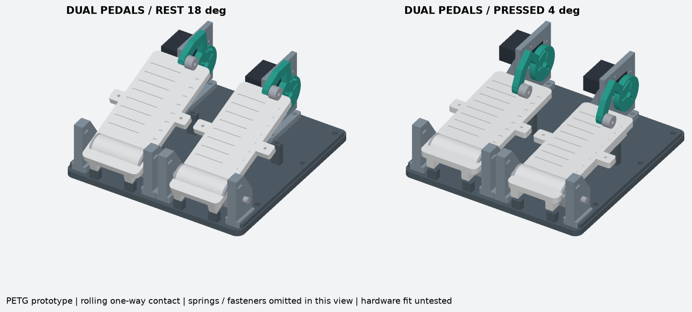
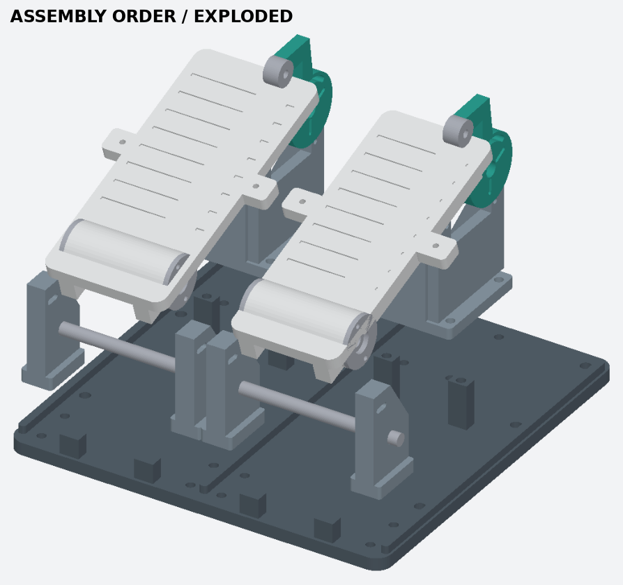

# Dual Pedals V5 — PETG 기구 시제품

가속·브레이크 두 개와 MG996R 두 개를 담는 독립형 기구다. 공용 베이스는 242 × 242 mm 한 장이며, 발판·힌지 지지대·서보 고정부는 조립식이다. 출력 가능한 CAD/STL과 A1 PETG 슬라이싱 파일을 제공한다. **실물 조립·반복 하중·서보 부하 시험은 아직 하지 않았다. 판매용 완제품이나 정격 브레이크가 아니다.** 펌웨어와 입력 센서는 이번 파일에 포함하지 않는다.

## 구동 구조

6발 순정 혼이 녹색 암의 포켓에 들어간다. 암 끝의 625 베어링 두 개가 발판 윗면을 누른다. 발로 더 누르면 발판이 롤러에서 떨어지므로 서보를 역으로 돌릴 필요가 없다. 복귀는 페달 양옆의 인장 스프링 두 개가 담당한다. 하단 스토퍼와 별도의 Ø8 축이 발판을 받는다. 롤러의 Ø5 클레비스 핀을 빼면 구동 연결이 해제된다.

- 가속 발판 폭 70 mm, 브레이크 폭 78 mm, 발판 길이 174 mm. 두 축 중심 간격 116 mm.
- 움직이는 혼과 발판은 직접 강체 링크로 묶지 않는다. 롤러 방식에는 와이어·장력 조절기가 필요 없다.
- 스프링 상단은 힌지 지지대의 길이 10 mm 슬롯에 고정한다. 이 위치로 초기 장력을 조정한다.
- 서보 암의 원호 슬롯과 M3 제한 핀은 명령 범위 바깥의 약 2° 여유를 둔다. 이 핀은 비상 과회전 제한용이다. 서보를 스토퍼까지 계속 밀어붙이지 않는다.
- 오른쪽 가속·왼쪽 브레이크는 현재 같은 이동 범위다. MG996R 부하 시험 전까지 브레이크도 가벼운 복귀 스프링을 쓴다. 자동차처럼 강한 브레이크 저항을 보장하지 않는다.

## 먼저 출력할 파일

`D-fit-coupon-PETG.gcode.3mf`는 6발 혼 포켓, Ø8 축, 608 베어링, 서보 플랜지 맞춤 시험편이다. 실제 부품에 맞는지 확인한 뒤 나머지를 출력한다. 혼 포켓이 헐겁거나 끼지 않으면 `model.py`의 변수를 수정한다. 베어링은 망치로 억지로 넣지 않는다.

| 변수 | 현재 값 | 상태 |
|---|---:|---|
| 혼 외경 | 32 mm | 참고값, 실물 확인 필요 |
| 넓은 팔 폭 | 7.32 mm | 사용자 측정값 |
| 팔 끝 폭 | 4.6 mm | 사용자 추정값 |
| 골 반경 | 8.1 mm | 종이 1번 윤곽 해석값, 확정 실측 아님 |
| 혼 두께 | 2 mm | 미확정 |
| 포켓 조립 여유 | 편측 0.3 mm | 시험편으로 확인 |
| 혼 작은 나사 홀 | 반경 6.5~14.5 mm 슬롯 3개 | 실제 세 구멍을 골라 체결 |
| 서보 플랜지 홀 | 49.5 × 10 mm, Ø3.5 | 호환품은 차이 가능 |
| 서보 몸통 통과구 | 41.5 × 21 mm | 시험편 확인 |
| 축 / 608 포켓 | Ø8.3 / Ø22.2 mm | 출력 오차 확인 |

중앙 Ø9.6 mm 구멍으로 순정 혼 고정 나사에 접근한다. 출력물에 25T 스플라인을 만들지 않았다. 혼 세 구멍과 슬롯에 금속 나사·너트로 고정한다. 혼 구멍을 넓히기 전에 사용할 나사의 호환 여부부터 확인한다.

## 출력판과 수량

| 판 | 내용 |
|---|---|
| A-base | 공용 베이스 1개 |
| B-pedals | 가속·브레이크 발판 각 1개, 윗면을 아래로 배치 |
| C-hardware | 힌지 지지대 4, 혼 암 2, 베어링 캡 4, 축 간격링 4, 롤러 간격링 2 |
| E-carriers | 서보 고정부 2개 |
| D-fit-coupon | 혼/축/베어링 시험편과 서보 플랜지 시험편 |

0.4 mm 노즐, A1, Generic PETG, 0.20 mm 적층, 벽 6겹, 상하 6겹, gyroid 35%. 외벽 80 mm/s, 내벽 120 mm/s. A판은 서포트·브림 없음. 나머지는 베드에서 시작하는 서포트와 4 mm 브림을 사용한다. 발판의 접촉면 아래에는 서포트가 생기므로 제거 후 롤러 트랙을 매끈하게 정리한다. 지지대는 옆으로 놓아 축 주변의 층 방향을 바꿨다. 슬라이서 통과는 강도 인증이 아니다.

단일 STL과 `model.py`, 배치 생성용 `plates.py`, 전체 조립 `assembly.step`도 제공한다. 3MF에 이미 필요한 개수가 들어 있으므로 다시 복제하지 않는다. 재질이 PETG-HF 등 다른 제품이면 실제 스풀 프로파일로 다시 슬라이싱한다.

## 구매·준비 부품 — 두 페달 합계

| 부품 | 수량 | 용도/조건 |
|---|---:|---|
| MG996R + 순정 6발 혼 + 순정 중앙 나사 | 각 2 | 호환품 치수 확인 |
| 608 베어링, 8 × 22 × 7 mm | 4 | 페달마다 2개 |
| 매끈한 Ø8 금속 축, 길이 120 mm | 2 | 나사산 봉 대신 평활 축 |
| Ø8 축용 고정 칼라, 폭 약 6 mm 이하 | 4 | 축 양끝 이탈 방지 |
| 625 베어링, 5 × 16 × 5 mm | 4 | 페달마다 롤러 2개 |
| Ø5 × 유효길이 약 30 mm 클레비스 핀 + 와셔 + R클립 | 2세트 | 암 8 + 간격링 2 + 베어링 10 mm를 관통, 실제 핀 길이 확인 |
| M5 × 25 볼트, 너트, 와셔 | 16세트 | 힌지 8, 서보 고정부 8. 너트는 베이스 아래 |
| M3 × 16 볼트, 너트, 와셔 | 8세트 | 서보 플랜지 |
| M3 × 75 볼트, 너트, 와셔 | 4세트 | 양쪽 베어링 캡을 관통 체결 |
| M3 × 35 볼트, 너트 2개, 와셔 | 2세트 | 서보 암 제한 핀. 암을 조여 고정하지 않도록 유격 유지 |
| M2 × 약 12 볼트, 너트, 작은 와셔 | 6세트 | 혼 체결; 실제 혼 구멍/두께에 맞춰 변경 |
| 인장 스프링 | 4 | 바깥지름 6 mm 이하 권장, 아래 계산 조건 참조 |
| M3 볼트·와셔·너트 및 스프링 고리 체결구 | 8세트 | 위쪽 슬롯 4, 발판 귀 4. 고리 형상에 맞춰 길이 선택 |
| M6 리그 체결 볼트·와셔·너트 | 6세트 | 베이스 + 실제 지지판 두께에 맞는 길이 |
| 단단한 지지판과 하부 너트 여유 | 1 | 베이스가 전 면적으로 지지되게 설치 |

열압입 인서트는 필요 없다. 나사·축·스프링·베어링은 금속 부품이다. PETG로 출력해 대체하지 않는다. 베이스 스토퍼의 Ø5.5 홀은 추후 마모 패드 체결용이며, 머리가 튀어나오는 볼트를 넣으면 정지 각도가 바뀐다. 초기 조립에서는 빈 상태로 둔다.

## 조립 순서

1. D판으로 혼 포켓·서보 플랜지·축·베어링 끼움을 확인한다.
2. A판을 단단한 지지판에 고정한다. 아래쪽 너트가 받침면을 밀어 베이스를 휘게 하지 않도록 너트 자리와 관통공을 마련한다.
3. 힌지 지지대 네 개를 체결한다. 슬롯이 있는 높은 쪽은 뒤꿈치 방향이다. 양쪽 Ø8 구멍의 축을 맞춘다.
4. 발판 양끝에 608 베어링을 넣고 캡 두 개를 M3 관통 볼트로 체결한다. 캡 구멍은 발판의 두 구멍과 맞춘다. 베어링 포켓을 과도하게 조여 변형시키지 않는다.
5. 축과 간격링을 넣고 양끝 칼라로 고정한다. 발판이 가볍게 회전하고 좌우 지지대에 닿지 않아야 한다.
6. 양쪽 스프링을 위쪽 슬롯과 발판 귀에 고정한다. 중립에서 들뜸 없이 복귀하고 아래 스토퍼까지 손으로 쉽게 눌리는 장력부터 시작한다.
7. 서보 고정부 두 개와 서보를 장착한다. 전선은 몸통 뒤쪽의 열린 공간으로 빼고 타이 슬롯에 느슨하게 고정한다. 전선이 지지대·암·발판 사이를 통과하지 않게 한다.
8. 전원을 끈 상태에서 순정 혼을 암 포켓에 넣고 세 군데 체결한다. 순정 중앙 나사로 서보축에 고정한다. 출력물과 서보 케이스 사이가 닿으면 혼 축방향 치수부터 수정한다.
9. 롤러 간격링·625 베어링 두 개를 Ø5 핀에 끼우고 와셔·R클립으로 고정한다. 베어링 외륜은 자유롭게 굴러야 한다. 핀 제거가 수동 해제다.
10. 제한 핀을 원호 슬롯에 넣는다. 핀을 캐리어 쪽에 고정하되 암 양면에는 유격을 둔다. 암이 전 구간에서 자유롭게 움직이는지 확인한다.
11. 최초에는 롤러 핀을 빼고 페달 수동 복귀와 스토퍼 접촉부터 확인한다. 이후 무부하 서보 각도를 맞춘 뒤 한 페달씩 결합한다. 이 CAD 각도를 PWM 마이크로초에 그대로 대응시키면 안 된다.

미리보기는 금속 나사·스프링을 생략한 기구 그림이다. STEP의 서보는 장착 공간 검토용 명목 외형이다.

## 계산·검증 범위

`verification.json`은 21개 동작 위치의 결과와 가정값을 포함한다. 각 위치에서 발판/베이스, 발판/좌우 지지대, 발판/캐리어, 발판/암, 암/캐리어, 암/제한 핀의 솔리드 교차를 검사했다. 롤러 접촉은 평면 법선 거리로 계산했다. 명령 위치보다 더 밟는 231개 조합에서 롤러와 발판의 분리 여유가 음수가 되지 않는지 확인했다. 연속 전 구간의 모든 하드웨어 접촉을 보증하는 검사는 아니다.

- 페달 회전 18° → 4°, 발끝 대표점 이동 약 35.4 mm.
- 서보 암 상대각 약 34.35° → −3.71°, 합계 약 38.06°.
- 롤러 접촉점은 축으로부터 발판 길이 방향 약 142.1 → 121.7 mm.
- 스프링 계산 예: 고리 간 자유 길이 70 mm, 초기 장력 0 N, 강성 0.6 N/mm, 2개/페달. 작동 고리 간 길이 약 74.8~80.5 mm. 실제 시판 인장 스프링의 초기 장력은 별도로 포함해야 한다.
- 위 가정에서 스프링만 반영한 서보 요구토크는 끝점에서 약 0.033~0.125 N·m. 마찰·가속·스프링 편차·서보 편차를 제외한 준정적 계산으로 연속 운전 허용토크가 아니다.
- 0.15 kg 발판과 무게중심 65 mm라는 가정으로 중력 복귀 방해 토크도 기록했다. 출력물·부품의 실제 질량/무게중심과 스프링을 재측정해야 한다.
- MG996R 정지토크를 연속 정격으로 사용하지 않았다. 실물에서 전류·발열·걸림을 보며 운전 범위를 정해야 한다.

남은 실물 확인: 혼 끼움과 나사 머리 여유, 모터 출력축 돌출량, 배선 출구, 스프링 실제 복귀력, 부하 상태의 서보 발열, PETG 장기 변형과 반복 하중. 별도 홀 센서/로드셀과 전자회로 없이는 사람이 누른 양을 PC에 입력할 수 없다.

## 참고와 재현

[SimPedals](https://github.com/dmcke5/SimPedals)의 양측 지지와 기구/센서 분리, [ThisOldScot](https://github.com/thisoldscot/Sim_Pedals)의 기성 부품 구성, [OpenSimPedals](https://github.com/manoukianv/OpenSimPedals)의 독립 입력, [DIY FFB Pedal](https://github.com/ChrGri/DIY-Sim-Racing-FFB-Pedal)의 대형 구동 구조를 비교했다. 이번 CAD는 새로 작성했으며 이들 프로젝트의 STL이나 CAD를 복사·변환하지 않았다. 고출력 FFB와 동급이라는 뜻이 아니다.

CadQuery 환경에서 `python model.py`, `python verify.py`, `python plates.py`, `python render.py` 순서로 재생성할 수 있다. 렌더에는 trimesh, numpy, matplotlib도 필요하다. 배치 STL 변경 후에는 3MF를 반드시 다시 슬라이싱한다.

## 최종 슬라이서 예상치

| 판 | 시간 | PETG |
|---|---:|---:|
| A-base | 13.83시간 | 355.10 g |
| B-pedals | 15.23시간 | 307.82 g |
| C-hardware | 6.36시간 | 134.86 g |
| E-carriers | 7.68시간 | 143.93 g |
| D-fit-coupon | 1.17시간 | 26.30 g |

전체 44.27시간 / 968.01 g. 시험편·서포트 포함 예상치이며 실제 시간과 사용량은 달라질 수 있다.
