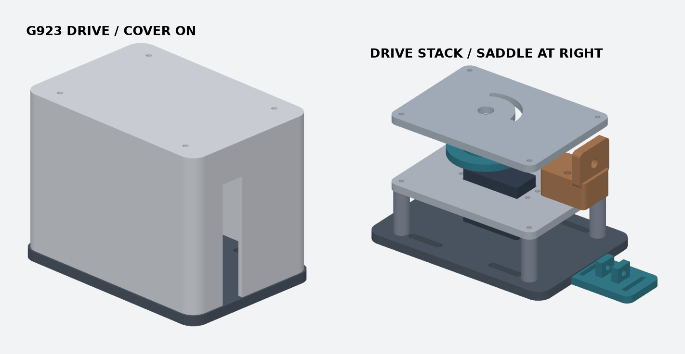

# G923 Drive · MG996R 와이어 구동기

G923 액셀 자동 구동을 위한 조정식 장착 키트. 외장은 둥근 단일 셸이며 서보, 6팔 혼 및 드럼, 기계식 회전 제한판을 감싼다. 페달 쪽 안장은 미리보기 오른쪽에 따로 표시했다. 렌더의 서보와 드럼은 배치 확인용 외형이다.

## 방식 선택

직결 링크는 강성이 높지만 페달 힌지와 서보 축의 정확한 정렬이 필요하고, 사용자가 밟을 때 서보를 역구동한다. 이 설계는 **보우든 케이블로 당기는 방식**을 사용한다. 페달을 더 밟으면 내선이 느슨해지는 쪽으로 고정점을 잡고, 수동 전환 때는 페달 안장의 핀을 뽑아 케이블을 물리적으로 분리한다. 전원 차단 자체는 해제 수단이 아니다.

## 출력 및 분해 순서

[분해도](exploded.png) · [A1 PETG 출력판](g923-drive-petg-complete.gcode.3mf). 출력판에는 구동기 기둥 4개가 포함된다. 혼·드럼과 페달 측 추가 타워는 별도 출력한다.

| 순서 | 부품 | 조립 |
|---|---|---|
| 1 | 01 베이스 | M5 볼트와 큰 와셔로 리그 판에 체결. G923은 같은 리그 판에 순정 장착부 또는 기존 고정 방식으로 고정한다. G923 케이스는 가공하지 않는다. |
| 2 | 03 기둥 4개 + 02 서보판 | M3 관통볼트/너트 또는 금속 스탠드오프로 베이스부터 적층. 서보는 09 시험편에 끼워 본 뒤 귀 4곳을 M3 볼트·와셔·너트로 고정한다. |
| 3 | 기존 6팔 혼과 드럼 | [혼 키트](../g923-horn/)를 참고한다. 혼 포켓은 1번 종이 윤곽을 반영했다. 실물 맞춤은 시험편에서 확인한다. 무부하에서 중심 나사 접근성과 회전 간극을 확인한다. |
| 4 | 05 높이 블록 + 04 케이블 타워 | 서보판의 슬롯에 M4 볼트·너트로 고정. 금속 M6 배럴 어저스터와 잠금너트를 끼운다. 기준 드럼 홈 높이는 베이스 기준 67.5 mm이며 실제 혼 높이에 맞춰 높이 블록을 조정한다. |
| 5 | 08 회전 제한판 | 서보판 위 41 mm 스탠드오프에 체결한다. 드럼의 R20 체결 위치 하나에 Ø3 mm 금속 핀을 연장하고, 제한판 슬롯에 들어가도록 혼의 위상을 맞춘다. 각 끝은 비상 기계 한계다. |
| 6 | 06 외장 | 제한판 위 10 mm 스탠드오프에 체결. 좌측 아래는 서보 리드, 우측 개구는 보우든 케이블 출구다. |
| 7 | 07 페달 안장 | 20 mm 저신축 웨빙과 고무 패드를 이용해 액셀 스템에 묶고, 두 귀 사이에 케이블 아이를 넣어 Ø4 mm 퀵릴리스 핀으로 고정한다. 케이블 외피의 페달 쪽 끝은 리그에 별도 고정한다. 04 타워를 추가 출력해 사용할 수 있다. |

외장, 판, 안장은 모델의 출력 방향으로 배치했다. A1 0.4 mm, 0.20 mm, PETG, 벽 4겹 기준이다. 타워의 짧은 수평 홀과 안장 귀 아래는 슬라이서에서 브리지 상태를 확인한다. 시험편은 PLA로 먼저 확인해도 된다.

## 스트로크와 토크

- R15 mm 드럼에서 106° 검증 구간의 감김 길이는 27.75 mm다. 슬롯 끝까지 강제로 밀지 않는다.
- 예제 좌표는 페달 피벗→앵커 75 mm, 페달 20°, 케이블 가이드 (85, -48) mm다. 0–100%를 1% 간격으로 계산했을 때 유효 당김량 22.38 mm, 드럼 회전 85.5°였다. 이 값은 G923 실측이 아니다.
- 드럼 토크는 케이블 힘 × 유효 드럼 반경 ÷ 전달 효율이다. 예를 들어 20 N과 효율 75%에서는 0.40 N·m다. TowerPro의 6 V 11 kgf·cm(약 1.08 N·m)는 정지 토크이며 연속 허용값은 확인되지 않았다.
- 제한판은 각도를 제한한다. 서보가 스토퍼를 밀거나 케이블이 걸리는 경우의 힘은 제한하지 못한다. 부하 시험에는 실측한 작동력보다 높고 검증한 기구·서보 한계보다 낮게 맞춘 인라인 기계식 과부하 해제부가 필요하다. 설정 범위가 겹치지 않으면 이 구동기 조합을 사용하지 않는다.

## 검증 범위와 조립 전 확인

CadQuery로 단일 유효 솔리드와 A1 크기 제한을 확인했다. 외장·서보판·타워·회전 제한판 간격과 핀 107개 자세(7–113°)의 간섭을 검사했다. 예제 페달 기하에서 0–100% 케이블 이동이 단조인지 검사했다. **실제 G923의 페달 스윕, 발·브레이크 간섭, 스템 안장 미끄럼, 케이블 해제와 하중은 미검증**이다.

실측 시 액셀 측면 기준의 피벗, 웨빙 위치, 0%와 100% 좌표, 같은 위치에서 당김 힘, 리그 가용 공간을 기록한다. 해제 핀은 운전자 발에서 떨어진 쪽에 두고, 케이블 분리 상태에서 페달이 정상 복귀하는지 먼저 확인한다.

재생성은 `python model.py`, 검증은 `python verify.py`로 실행한다. CadQuery가 필요하다.

[MG996R 제조사 사양](https://towerpro.com.tw/product/mg996R/)
