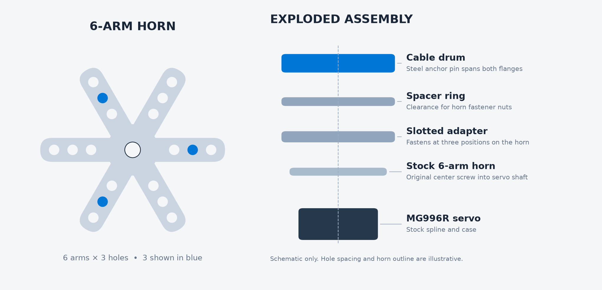

# G923 MG996R 6팔 혼 드럼 시험편

그림의 혼은 팔 6개와 팔당 구멍 3개를 보여주는 개략도다. 파란색으로 표시된 것처럼 같은 반경에서 120° 간격으로 세 곳을 고른다. 그림 속 구멍 간격은 실측값이 아니다.

혼은 MG996R 스플라인에 끼우고 순정 중앙 나사로 고정한다.
01 플레이트는 혼 위에 얹고, 혼 구멍과 플레이트의 방사형 슬롯을 볼트로 체결한다.
플레이트 밑면은 A4 도안 01번을 바탕으로 팔 6개의 직선 옆면과 둥근 끝을 적용했다.
안쪽 폭 7.32 mm, 끝 쪽 폭 4.6 mm를 적용했다. 외경 32 mm, 골 반경 8.1 mm, 두께 2 mm는 비교용 가정이다. 포켓에는 한쪽당 0.3 mm 여유를 줬다.
슬롯 중심 반경은 6.5–14.5 mm, 슬롯 폭은 2.5 mm다. 중앙 Ø9.6 mm 구멍은 순정 나사와 공구가 지나가는 통로다.
최소 세 곳을 120° 간격으로 체결할 수 있는지 실물로 확인한다.

혼 → 01 플레이트 → 03 스페이서 → 02 드럼 순서로 조립한다.
스페이서는 혼 체결용 너트가 들어갈 3.4 mm 공간을 만든다.
드럼과 플레이트의 바깥쪽 세 구멍은 M3 체결용이다.
드럼·스페이서·플레이트를 M3 × 20 관통 볼트 3개와 와셔·풀림 방지 너트로 체결한다. 아래쪽 너트와 서보 케이스 사이에 회전 여유가 있는지 확인한다.
팔에 있는 구멍 18개 중 120° 간격의 같은 반경 세 곳만 사용한다. 혼 구멍에 들어가는 금속 볼트의 지름은 실물에 맞춘다.

드럼의 기준 반경은 15 mm다. 와이어는 끝에 작은 압착 루프를 만들고 홈 안에서 Ø2.5 mm 금속 앵커 핀에 건다.
핀은 위아래 플랜지를 모두 관통한다. 앵커는 길이 18 mm 안팎의 M2.5 볼트 또는 같은 직경의 고정 가능한 핀을 사용하며, 케이블 루프가 닿는 구간은 매끈한 몸통을 쓴다.
윗면에는 머리 자리, 스페이서에는 하부 너트 여유가 있다. 핀과 너트가 케이블이나 혼에 닿는지 무부하에서 확인한다.
이 파일은 혼 맞춤과 무부하 감김 확인용이다. G923 장착 브래킷과 페달 앵커는 실측 후 설계한다.
