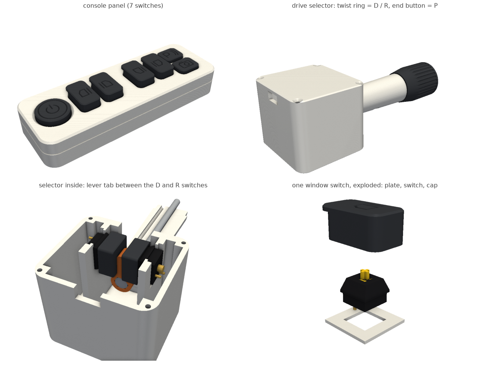

# ioniq-controls: 아이오닉 6 느낌 실내 조작부 (기계식 스위치 10개)



산 스위치 10개(Gateron Yellow, SMG SZH-SW033, 리니어 50 gf, 총 4.0 mm, 작동점 2.0 mm)로 만드는 1:1 조작부입니다.
현대 로고나 상표는 넣지 않았고, 아이콘은 일반 기호만 썼습니다.

1. **센터콘솔 "브릿지" 버튼 패널, 스위치 7개**: 파워윈도 4개, START/STOP(둥근 캡과 45° 링), 주차 보조(P), 카메라.
   크기 190 x 66 x 29 mm입니다. 윈도 캡은 누르면 내려가고, 앞쪽 립은 들어 올리는 모양만 냈습니다(스위치는 하나).
2. **칼럼식 변속 레버(스티어링 칼럼 스토크), 스위치 3개**: 끝의 링을 위(먼 쪽)로 돌리면 D, 아래(내 쪽)로 돌리면 R이고,
   손을 놓으면 가운데(N)로 돌아옵니다. 끝 버튼을 누르면 P입니다. 책상 위에 놓는 블록(60 x 66 x 55 mm)에서
   스토크가 64 mm 나오고, 끝에 링(지름 34 mm, 길이 41 mm)이 달립니다. 조이스틱처럼 흔들리는 데는 없습니다.

## 출력 (Bambu A1, PLA, 벽 3겹, 서포트 없음, 브림 없음)

| 순서 | 파일 | 들어 있는 것 | 시간 / 무게 |
|---|---|---|---|
| 1 | `stem_tester.gcode.3mf` | 스템 맞춤 시험편 (소켓 4개) | 14 m / 2.5 g |
| 2 | `panel.gcode.3mf` | 베젤, 스위치 판, 바닥 상자, 캡 7개 | 4 h 08 m / 154 g |
| 3 | `stalk.gcode.3mf` | 블록, 뚜껑, 스토크 위·아래 반쪽, 링, P 캡, 누름컵 2개, 레버 | 3 h 28 m / 113 g |

**시험편을 먼저 뽑으세요.** 소켓 옆 점의 개수가 크기입니다: 1점 4.00 x 1.25, 2점 4.05 x 1.30, **3점 4.10 x 1.35(기본값)**, 4점 4.15 x 1.40.
스위치 스템에 끼웠을 때 손으로 빠지되 거꾸로 들어도 떨어지지 않는 것이 맞는 크기입니다.
3점이 아니면 그 크기로 다시 만들고 다시 슬라이스합니다:
`CROSS_L=4.05 CROSS_W=1.30 uv run ... python ioniq-controls/controls.py`

모든 부품은 넓은 면이 바닥에 닿도록 놓여 있습니다. 공중에 뜨는 면도 검사했습니다(아래 표).
- 베젤, 스위치 판, 캡, 뚜껑, P 캡, 누름컵은 윗면이 바닥에 닿게 뒤집혀 있어서, 윗면이 PEI 질감으로 나옵니다.
- 스토크는 반으로 갈라서, 가른 면을 바닥에 놓고 뽑습니다.
- 링은 앞면을 바닥에 놓습니다.

### 공중에 뜨는 면 검사 (`ceil.py`: 법선 z < -0.98, 바닥 위 0.3 mm 초과)

| 플레이트 | 평평한 천장 | 45°보다 눕는 오버행 (법선 z < -0.75) |
|---|---|---|
| stem_tester | 0 mm² | 0 mm² |
| panel (10개 부품) | 0 mm² (모든 부품) | 0 mm² |
| stalk (9개 부품) | 0 mm² (모든 부품) | 0 mm² |

이렇게 만들었습니다.
- 위로 갈수록 좁아지는 구멍은 모두 45°로 좁아집니다: 원뿔 카운터싱크, 링 안의 피라미드 시트와 원뿔 천장, 스토크 홈의 45° 지붕.
- 아이콘 홈은 45° 원뿔로 판 V홈이라서 바닥면이 없습니다.
- 스위치 판은 클립이 걸리는 자리만 1.5 mm로 얇습니다. 그 아래 클립 여유 공간은 나중에 출력되는 쪽(위)으로 열려 있습니다.
- 블록 안 스위치 벽의 U자 홈, 케이블 구멍, 스토크 꽂는 홈은 모두 위쪽이 열려 있고 뚜껑이 막습니다. 브리지가 없습니다.
- 바닥 모서리는 45° 모따기입니다. 세워서 뽑는 기둥이나 스탠드오프는 없습니다.

## 살 것

| 품목 | 수량 | 쓰는 곳 |
|---|---|---|
| Gateron Yellow (MX 호환, 3핀/5핀 모두 됨) | 10 | 패널 7, 스토크 3 |
| M3 x 25 접시머리 볼트 (ISO 10642 / DIN 7991) | 6 | 패널: 바닥 → 스위치 판 → 베젤 (베젤에 지름 2.6 파일럿 구멍, 나사산이 PLA를 깎고 들어감) |
| M3 x 12 접시머리 | 4 | 블록 뚜껑 |
| M3 x 16 접시머리 | 1 | 스토크 두 반쪽 (아래에서) |
| M5 x 100 육각 볼트 (전산 또는 반나사) | 1 | 회전축: 머리는 레버에, 끝은 링 안의 너트에 |
| M5 나일론 너트 (DIN 985) | 1 | 링 안 육각 포켓 |
| 전선 24~26 AWG 연선 + 수 듀폰 점퍼 | 패널 8가닥, 스토크 4가닥 | mikroBUS 소켓에 바로 꽂음 |
| 고무발 | 4 + 4 | 블록이 가벼워서(약 70 g) P를 누르면 밀립니다. 고무발이나 양면테이프를 쓰세요 |

## 핀 맵 (스위치 → mikroBUS)

스위치마다 한 다리는 신호 핀에, 다른 다리는 공통 GND에 연결합니다. 입력은 풀업이고, 누르면 LOW입니다.
GND는 부품 안에서 스위치끼리 이어 한 가닥으로 뺍니다. 그래서 패널 선은 신호 7 + GND 1 = 8가닥, 스토크 선은 신호 3 + GND 1 = 4가닥입니다.

| 스위치 | mikroBUS 핀 | 비고 |
|---|---|---|
| WIN_FL 앞 왼쪽 창 | AN | |
| WIN_FR 앞 오른쪽 창 | RST | 호스트가 RST에 리셋 회로를 달아 두었는지 확인 |
| WIN_RL 뒤 왼쪽 창 | CS | |
| WIN_RR 뒤 오른쪽 창 | SCK | |
| START/STOP | MISO | |
| PARK (P 주차 보조) | MOSI | |
| CAM (카메라) | PWM | |
| 변속 D | RX | |
| 변속 R | TX | |
| 변속 P (끝 버튼) | INT | 인터럽트 가능 핀 |
| (남음) | SCL, SDA | I2C는 그대로 비워 둠 |
| 공통 | GND | 두 묶음의 GND |

```c
// mikroBUS -> 스위치. MB_xx 는 T1S 노드 보드의 mikroBUS 핀 번호로 정의할 것. INPUT_PULLUP, LOW = 눌림.
static const struct { const char *name; int pin; } SW[] = {
  {"WIN_FL", MB_AN},  {"WIN_FR", MB_RST}, {"WIN_RL", MB_CS},  {"WIN_RR", MB_SCK},
  {"START",  MB_MISO},{"PARK",   MB_MOSI},{"CAM",    MB_PWM},
  {"D",      MB_RX},  {"R",      MB_TX},  {"P",      MB_INT},
};
void setup() { for (auto &s : SW) pinMode(s.pin, INPUT_PULLUP); }
// 기어: D와 R이 둘 다 HIGH 이면 N. P는 누를 때마다 P로 감. 5~10 ms 디바운스.
```

## 조립

### 패널

1. 스위치 7개를 스위치 판 **윗면에서** 끼웁니다. 클립이 1.5 mm 판 아래에 걸립니다.
2. 다리에 선을 납땜합니다. 신호선은 하나씩, GND는 모두 이어 한 가닥으로 만듭니다.
3. 선 묶음은 바닥 상자의 앞쪽(+y, 계기판 방향) 벽 위 홈(14 x 5)으로 뺍니다.
4. 판을 바닥 상자 위에 얹고, 베젤을 덮습니다. 판은 베젤 테두리 안에 들어갑니다.
5. 뒤집어서 아래에서 M3 x 25 접시머리 6개를 조입니다.
6. 캡은 베젤 구멍으로 넣어 스템에 꽂습니다. 윈도 캡은 립이 앞(+y)을 향하게 놓습니다.
   - 아이콘 방향: 창 그림의 위쪽이 바깥(왼쪽 창은 왼쪽)을 향하고, 기울어진 변이 앞/뒤 필러입니다.
   - 캡은 판 위 3.6 mm에서 멈춥니다. 스위치 바닥(4.0 mm)까지 내려가지 않습니다.

### 변속 레버

1. P 스위치에 선 2가닥(약 25 cm)을 납땜합니다. 링 **앞쪽에서** 밀어 넣으면 클립이 14 mm 사각 뒤에 걸립니다.
   선은 링 안의 지름 2.6 구멍으로 뒤로 빼고, P 캡을 꽂습니다.
2. M5 나일론 너트를 링 뒤쪽 육각 포켓에 넣습니다.
3. M5 x 100 볼트를 레버의 육각 포켓에 머리부터 넣습니다.
   볼트는 아래 반쪽의 가운데 홈에, P 선은 옆 홈(y = +7.5)에 눕히고 위 반쪽을 덮습니다.
   아래에서 M3 x 16 하나로 조입니다.
4. 링을 들고 레버를 돌려서, 볼트를 링의 너트에 감아 넣습니다.
   - 링 뒷면이 스토크 턱에서 0.3 mm쯤 떠서 걸림 없이 돌고, 앞뒤 유격은 없게 맞춥니다.
   - 레버 탭이 위를 볼 때 링의 선 구멍이 스토크 선 홈과 같은 쪽에 와야 합니다.
   - 1/6바퀴(0.13 mm)씩 조절하면 육각 방향이 계속 맞습니다.
5. D/R 스위치 2개에 선을 납땜합니다. 블록 안 두 벽의 U홈에 **위에서** 내려 꽂습니다.
   - 클립이 U홈의 양옆 세로 변에 걸리도록 스위치를 돌려서 넣습니다.
   - 스템에 누름컵을 꽂습니다.
6. 스토크 뿌리(사각 장부와 안쪽 플랜지)를 블록 앞벽의 홈에 위에서 내려 넣습니다. 레버 탭은 두 누름컵 사이에 들어갑니다.
   - 두 스위치가 0.5 mm씩 눌린 상태로 가운데(N)를 잡습니다.
7. 선을 바닥으로 뒤쪽에 모아 뒷벽 위 홈으로 뺍니다. 뚜껑을 덮고 M3 x 12 4개로 조입니다.
   뚜껑의 블록(plug)이 스토크 장부를 위에서 눌러 고정합니다.
8. 블록을 스토크가 오른쪽을 향하게 놓았을 때, **먼 쪽(+y) 스위치가 D**, 가까운 쪽이 R입니다.
   - 링 윗면을 먼 쪽으로 굴리면 D이고, 아이오닉처럼 "위로 돌리면 D"입니다.
   - 반대로 느껴지면 핀 맵에서 RX와 TX를 바꾸면 됩니다.

링 조작감입니다. 탭은 축에서 16 mm 떨어져 있습니다.
- 5.4°에서 D 또는 R이 들어옵니다.
- 11.2°에서 누름컵 테두리가 벽에 닿아 멈춥니다. 이때 스위치는 3.6 mm 눌려 있고, 바닥까지 가지 않습니다.
- 링 바깥(반지름 17 mm)에서 손가락에 걸리는 힘은 작동점에서 약 47 gf입니다.
- 중심 부근에서는 두 스프링이 같이 밀어서, 한쪽만 밀 때보다 두 배로 단단히 가운데를 잡습니다.

## 확인할 가정 (실물로 재 볼 것)

- **스위치 치수**는 MX 표준값으로 잡았습니다: 하우징이 판 윗면에서 6.6 mm, 스템 끝이 10.2 mm, 판 아래 5.0 mm + 다리 3.3 mm.
  Gateron은 보통 같지만, 스템 끝 높이가 다르면 캡이 그만큼 뜨거나 가라앉습니다.
  `controls.py` 맨 위의 `HOUSING_TOP`, `STEM_TOP`을 고치면 됩니다.
- **캡의 스템 튜브**(지름 5.5)는 끝까지 누를 때 하우징 윗구멍으로 3.4 mm 들어갑니다. 일반 키캡과 같은 방식입니다.
  걸리면 튜브 지름을 줄이세요(`TUBE_D`).
- **스템 맞춤**: 기본값 4.10 x 1.35. 시험편으로 확인하세요.
- **클립 판 두께**: 모든 자리가 1.5 mm입니다. 클립이 헐겁거나 빡빡하면 프린터 오차 때문입니다.
  스위치를 끼울 때 손으로 "딸깍" 들어가는지 확인하세요.
- 스위치 판 구멍은 14.0 mm로 그렸습니다. A1은 구멍이 0.1~0.2 mm 작게 나올 수 있으니, 안 들어가면 줄로 살짝 다듬으세요.
- 5핀 스위치의 플라스틱 다리 두 개는 판 아래 빈 공간에 들어갑니다. 잘라낼 필요가 없습니다.
- 링의 P 스위치는 링과 함께 ±11° 돕니다. 선이 그만큼 비틀리도록 스토크 끝과 링 사이에 1.7 mm 여유 방이 있습니다.
- 아이오닉 6 실물 배치와 크기는 사진과 자료로 잡은 근사치입니다.
  센터콘솔에 앞 창문 스위치가 있는 "브릿지형" 콘솔이고, 변속은 칼럼식 회전 노브에 끝단 P 버튼입니다.
  이 패널은 윈도 4개를 한 줄로 놓았습니다.

## 다시 만들기

```sh
uv run --with cadquery --with trimesh --with numpy --with vtk --with matplotlib --with scipy --with networkx \
  --with manifold3d --with shapely --with rtree python ioniq-controls/controls.py      # STL + preview.png
SET="wall_loops=3 brim_type=no_brim" bambu-cli/slice.sh ioniq-controls/panel.gcode.3mf ioniq-controls/out/panel_*.stl ioniq-controls/out/cap_*.stl
SET="wall_loops=3 brim_type=no_brim" bambu-cli/slice.sh ioniq-controls/stalk.gcode.3mf ioniq-controls/out/stalk_*.stl ioniq-controls/out/stalk_cup.stl
```

`out/`의 STL은 모두 출력 방향으로 놓여 있습니다. `controls.py`는 조립 좌표로 부품을 만든 뒤 뒤집어서 저장합니다.
`render.py`는 미리보기 4장을 그립니다: 패널, 레버, 레버 속, 스위치와 캡 분해도.
