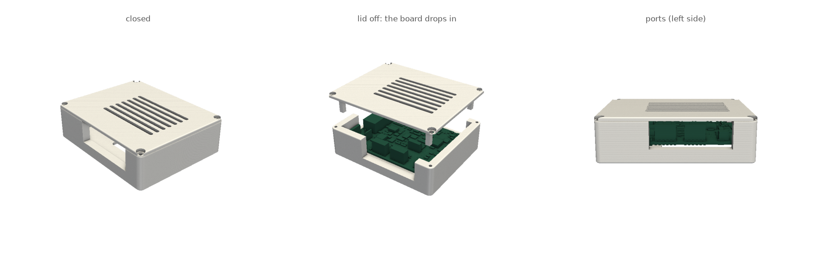

# KA7-UNO CAN board case v2

Copy for printing. Source, board model and port data: [stl-model/ka7-uno-can-board](https://github.com/hwkim3330/stl-model/tree/main/ka7-uno-can-board) (`case_v2.py`).

- `ka7_case_v2.gcode.3mf`: base + lid on one A1 plate, PLA, 3 walls, no supports, no brim, **1 h 50 m / 62 g**.
- 84 x 104 x 30.3 mm plain box, nothing sticks out.
- No posts, standoffs or board screws: the board's corners sit on pads in the wall corners, the lid's corner columns clamp them.
- Hardware: 4 x M3 x 10 self-tapping (lid) + 4 rubber feet (floor open under the AC7200 SoM for its heatsink).
- Generous port windows (MATEnet T1S, RJ45, terminals): one per side, connector + 3 mm a side, up to the lid.
