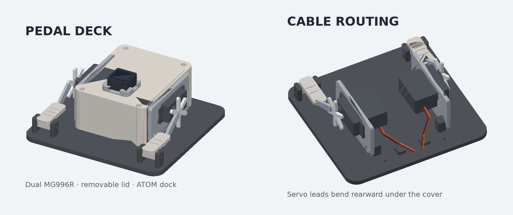
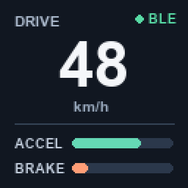

# Pedal Deck · 듀얼 MG996R 탁상 데모

브레이크 G2(왼쪽)와 액셀 G1(오른쪽)을 구동하는 166 × 156 mm 데모.
서보 출력축은 바깥을 보고, 두 서보의 케이블 끝은 뒤를 향한다.
상단 커버는 나사로 탈착하고, ATOM 도크는 얇은 탈착식 테이프로 고정한다.

## 출력

1. **01-fit-check.stl** 또는 **fit-check.gcode.3mf**부터 출력한다. 4 mm 시험편에 서보 몸통과 귀 4개를 대본다. 설계값은 몸통 창 41.5 × 20.5 mm, 귀 구멍 중심 49.5 × 10 mm, 관통 구멍 Ø3.4 mm다.
2. 맞으면 **pedal-deck-pla.gcode.3mf**를 Bambu Studio로 연다. A1 0.4 mm, PLA, 0.20 mm, 벽 4겹, 20% 인필로 슬라이스한 한 판이다. 슬라이서 추정 4시간 32분, 169 g. 프린터와 필라멘트 선택을 확인한다.
3. STL을 직접 슬라이스할 때 02–08을 불러오고 **03과 08은 각 2개** 배치한다. STL은 출력 방향으로 놓여 있다. PETG를 쓰면 PETG 프로파일로 다시 슬라이스한다.

## 조립

- 03 캐리어를 양쪽 베이스 기둥에 M3 볼트와 너트로 붙인다. MG996R은 바깥에서 캐리어 창에 넣고, 귀 4개를 체결한다. 두 캐리어는 같은 부품을 반대쪽에서 뒤집어 쓴다. **스플라인은 바깥쪽, 케이블이 나오는 몸통 끝은 뒤쪽**이다.
- 케이블은 몸통 출구에서 느슨하게 구부려 뒤쪽 두 고정 고리에 묶는다. 커버 뒤쪽의 약 20 × 15 mm 개구는 아래가 열려 있어서 플러그를 뽑거나 디핀하지 않고 커버를 씌울 수 있다. 서보 출구와 고정점 사이에 여유를 둔다.
- 두 페달을 M3 × 35 볼트와 너트로 힌지에 달고 가볍게 회전하는지 확인한다. 커버는 M3 × 8 나사 4개로 베이스에 고정한다. ATOM 도크는 USB-C·Grove·리셋 방향을 맞춘 다음 커버에 붙인다.
- 서보를 1500 µs로 센터링한 뒤 **6팔 혼에서 앞쪽을 향하는 팔 하나의 안쪽 구멍**을 쓴다. 링크의 29.5 mm 구멍부터 시험하고, 실물 혼의 홀 위치에 따라 26/33 mm 구멍을 고른다. 링크는 양쪽 M2 볼트·와셔·풀림방지 너트로 움직일 만큼만 조인다. 혼과 페달 러그의 축 방향 단차는 와셔로 맞춘다.
- 기존 G2 스케치는 링크 없는 테스트용이다. 링크를 건 뒤에는 ±10° 이내에서 시작해 양방향 끝 위치를 보정한다. 실물 혼의 전체 회전, 케이블 꺾임, 커버 간섭을 손으로 먼저 확인한다. 발로 밟지 않는 탁상용이다.

## 화면 콘셉트

속도 숫자를 가장 크게, BLE 링크 상태를 상단에, ACCEL/BRAKE 명령 막대를 하단에 배치한다. 화면 값은 예시다.

## 모델 확인

모든 STL의 단일 폐합 메시와 A1 베드 크기를 확인했다. 중립 자세에서 베이스·커버·서보 캐리어·페달의 CAD 겹침을 검사했다. 서보와 혼 치수는 추정값을 포함하며 실물 출력과 조립으로 확인할 항목이다.

재생성: `uv run --with manifold3d --with trimesh --with numpy python model.py`.
