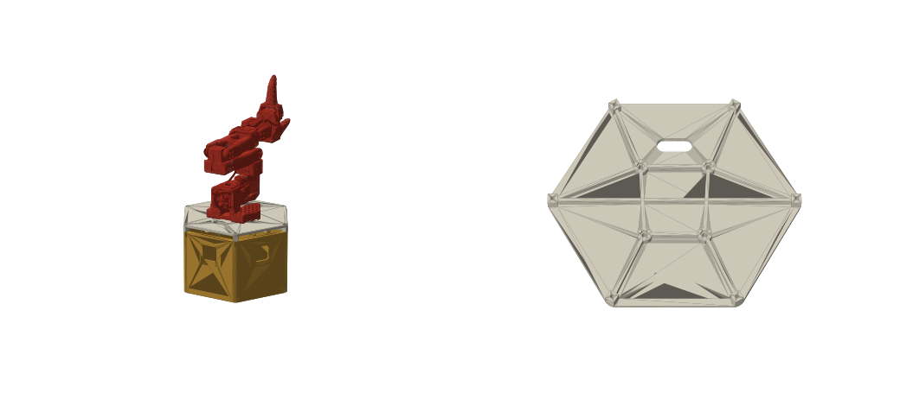

# SCOUT MINI sensor box (print version)

One-piece hexagonal box for the Bambu Lab A1, PLA, open top. One camera per face (6 cameras, 60° apart), with a Jetson AGX Orin inside. The original sheet-metal design is in [scout-mini-sensor-box](https://github.com/hwkim3330/scout-mini-sensor-box) (REV9), and its panel-assembled print version is in that repo's `rev10p/`.

3D: [v10/assembly.stl](v10/assembly.stl) · Source: [box.py](box.py) (all dimensions at the top; `VERSION` sets the output folder)

## Versions (one-piece body)

| Version | What changed | Body print | 3D |
|---|---|---|---|
| [v0-compare](v0-compare/) | Plain cups to compare shapes: round Ø245 vs hexagon (2.4 mm wall, windows only) | round 6 h 55 m / 395 g, hex 5 h 12 m / 329 g | [round](v0-compare/round.stl) · [hex](v0-compare/hex.stl) |
| [v1](v1/) | Hexagon with everything: 2.8 mm walls, corner columns, 45° floor fillet and top lip, camera pads, vents, floor holes | 9 h 02 m / 371 g (0.2 mm) | [body](v1/body.stl) |
| [v2](v2/) | 2.5 mm walls (exactly 6 lines, no gap fill), smaller columns, 0.24 mm layers | 8 h 02 m / 360 g | [body](v2/body.stl) · [assembly](v2/assembly.stl) |
| [v3](v3/) | Camera test fit the real camera; camera plate opening made square | body same as v2 | [body](v3/body.stl) · [camera plate](v3/cam_plate.stl) |
| [v4](v4/) | The clear housing is flush with the red holder's top edge (the cable is at the bottom), so the plate opening moves up 2.39 mm. The M2 holes stay symmetric on the red holder. Now the two lower holes are full circles; the two upper ones still touch the opening because they sit right beside the clear housing | body same as v2 | [camera plate](v4/cam_plate.stl) · [assembly](v4/assembly.stl) |
| [v5](v5/) | **Simpler: no camera plates.** The camera mounts straight on the wall. The clear housing goes out through an opening in the wall, the red holder sits in a 1 mm pocket inside a 4 mm pad, and 4 × M2 × 6 go from outside into the red holder. That removes 6 plates and 24 M3 screws | 7 h 57 m / 365 g | [body](v5/body.stl) · [camera test](v5/cam_test.stl) · [assembly](v5/assembly.stl) |
| [v6](v6/) | Outer corners rounded R12 instead of R3: softer look, and big round corners are less likely to lift on a 236 mm print. The corners stay about 8 mm thick thanks to the inner columns. Camera mount = v5 (variant 1, checked on paper) | 7 h 53 m / 363 g | [body](v6/body.stl) · [assembly](v6/assembly.stl) |
| [v7](v7/) | Fixes from an independent review of v6: the outer rail-bar bolt holes were buried under the 45° floor fillet (bolts now at x ±20/±60); the AGX holes sat on top of the rail bar (AGX centred, bars moved to y ±70); the lid pilot holes were sealed by the top lip; the M4 nut pocket was 7.01 mm across flats for a 7.0 mm nut (now 7.27); added a cable slot under each camera pocket, a 45° slope under the camera pads, and 4 high vents per face so it can still exhaust with a plate on top | 7 h 57 m / 360 g | [body](v7/body.stl) · [assembly](v7/assembly.stl) |
| [v8](v8/) | Ribbon channel: the camera's thin ribbon leaves between the clear housing and the red holder, which sat flat against the wall and would pinch it. An 18 mm wide, 0.8 mm deep channel now runs in the wall face under the red holder, from the opening's lower edge down to the cable slot | 8 h 02 m / 359 g | [body](v8/body.stl) · [camera test](v8/cam_test.stl) · [assembly](v8/assembly.stl) |
| [v9](v9/) | Cleaner and steadier for the 8-hour print: the low vent slots are gone (the top is open; fewer bridges and nozzle hops), a row of nine 3.5 mm round holes under the top edge of each face keeps an exhaust if a plate covers the top, a 1 mm recess outside each camera puts the M2 heads below the surface, 1 mm chamfer on the top edge. Camera mount otherwise = v8 | 7 h 19 m / 372 g (sliced file: 7 h 44 m) | [body](v9/body.stl) · [camera test](v9/cam_test.stl) · [assembly](v9/assembly.stl) |
| [v10](v10/) | **Camera mount from the maker's CAD** (Arducam U6251 STEP, [Cytron's copy](https://drive.google.com/file/d/1SclpUZ56z3HF0iqqUI_ViT3byzcXrxU6/view), kept in `ref/` but not committed) and a clean outside. The opening follows the clear housing's rounded outline with an even 0.25 mm gap (v9: square, 0.04 mm at the bottom by the CAD), the pocket follows the red holder's outline, M2 at 34.0 x 29.0 from the CAD. The red holder's holes are 2.4 mm through, so the M2 x 6 now go in **from inside** through them into blind 1.7 mm pilots in the wall: no screw heads or recess outside. Wall in front of the camera 4.5 mm (6.9 mm of the clear housing shows). Checked against the real CAD solids on all six faces: no collisions | **7 h 44 m / 380 g** | [body](v10/body.stl) · [camera test](v10/cam_test.stl) · [assembly](v10/assembly.stl) |
| **[v11](v11/)** (current) | Nothing on the outer faces: the row of exhaust holes under the top edge is gone. The AGX cables now leave through the floor: two 30 × 40 mm holes (R10), one each side of the AGX at x ±80, clear of the AGX (10 mm) and the rail bars. A floor hole prints as plain perimeter, no sagging bridge as a wall hole would. The holes are also the cool-air intake; the open top is the exhaust (a lid later sits on spacers). Camera mount = v10 | **7 h 33 m / 377 g** | [body](v11/body.stl) · [camera test](v11/cam_test.stl) · [assembly](v11/assembly.stl) |

Note: the M2 holes (34.1 × 29.0, symmetric on the red holder) sit right beside the clear housing. Since v4 only the upper two cut into the opening.

## Print (v11)

| File | Part | Time | PLA |
|---|---|---|---|
| `v11/cam_test.gcode.3mf` | Camera test: the wall's camera mount cut out as one small piece | 22 m | 8 g |
| `v11/body.gcode.3mf` | Body (one piece, 0.24 mm layers) | **about 7 h 33 m** | 377 g |
| `v11/rail_bars_x2.gcode.3mf` | Rail bars ×2: slots now centred on the rails, 230 mm apart (SCOUT MINI OMNI manual p.19), M5 | 1 h 30 m | 60 g |

- **Paper check (no printing):** [v5/cam_template_A4.pdf](v5/cam_template_A4.pdf) has the four variants below on one A4 sheet, numbered 1-4 at 1:1 (made by `cam_template.py`). Print it at 100 % (actual size), check the 100 mm bar with a ruler, and lay the camera on each one.
- **Or pick from four:** `v5/cam_test_variants.gcode.3mf` (52 min) puts four test pieces on one plate. Count the small holes in a corner to tell them apart:
  1. M2 centres 34.1 × 29.0, opening up 2.39 mm (= v5)
  2. 33.0 × 27.9, up 2.39
  3. 31.9 × 26.8 (the caliper reading taken as centre distance), up 2.39
  4. 34.1 × 29.0, opening centred

  **Result (2026-10-27): variant 1 fits (A4 check) = v5 as it is.**
- **Camera test first:** fit the real camera into it. The clear housing goes out through the opening, the red holder drops into the pocket, and 4 × M2 × 6 go in from the inside, through the red holder into the wall.
- **Body:** it takes about 8 hours, so start it in the morning and wash the bed plate first.
- **Rail bars:** print them after the robot arrives. The body doesn't depend on the rails.

## Body design

- **Size:** 240 mm across corners (fits the 256 mm bed), 208 mm across flats, 130 mm tall. The AGX (110 × 110 × 72) fits inside, checked in code.
- **Walls 2.5 mm:** exactly 6 lines of 0.42 mm (3 per side), so the slicer has no slow gap fill to do.
- **Floor 3.2 mm:** with an M3 grid every 20 mm, the AGX holes (90 × 90), and M4 holes for the rail bars.
- **Strength, all of it printable without supports:**
  - Square columns in the six inside corners, with M3 pilot holes on top for a lid or lidar plate later.
  - A 45° fillet strip all round where the walls meet the floor.
  - A 45° lip around the inside of the top rim, which stiffens it and gives a lid something to sit on.
  - 4 mm pads inside around each camera, so the M2 screws have material to bite (45° underside, cable slot below the pocket).
  - A 0.5 mm chamfer on the first layer to prevent elephant foot.
- **Vents (v9):** the top is open; a row of nine 3.5 mm round holes under the top edge of each face is the exhaust if a plate covers it.

## Camera mounting (v10, from ref/U6251.STEP)

`box.py` needs `ref/U6251.STEP` (not committed; download it from [Cytron's link](https://drive.google.com/file/d/1SclpUZ56z3HF0iqqUI_ViT3byzcXrxU6/view), product page: cytrontech.vn "Enclosure Case for Raspberry Pi Camera Module").

- **Red holder** 40.12 × 35.12, plate 3.5 thick, sits in a 1 mm pocket that follows its outline (+0.3 mm) in a 5.5 mm pad inside the wall.
- **Clear housing** 31.5 × 30.5, 11.4 above the red plate, flush with its top edge. The wall opening follows its rounded outline with an even 0.25 mm gap; the wall in front of the camera is 4.5 mm, so 6.9 mm shows outside.
- **Screws:** M2 × 6, four per camera, from inside through the red holder's 2.4 mm holes (34.0 × 29.0) into 1.7 mm blind pilots, 3 mm deep (1.5 mm of wall left outside). Mount the cameras before the AGX.
- **Ribbon:** it leaves through a 17.5 × 1.5 notch at the bottom of the clear housing, right on the red holder, into the 18 × 0.8 channel down to the cable slot. (The red holder also has a 25 × 6 slot in its back if the ribbon is routed straight into the box.)
- `box.py` reads the STEP and checks the real solids against the body on all six faces.

## Camera mounting (measured, v5)

- **Red holder** (40.16 × 35.03 × 3.51) sits in a 1 mm pocket (41 × 36) on the inside of the wall. The wall is 4 mm thick there, and 3 mm at the opening.
- **Clear housing** (31.74 × 30.25, 10.9 tall) is flush with the red holder's top edge (the cable is at the bottom). It goes out through a 32.3 × 30.8 opening that sits 2.39 mm above centre, so about 7.9 mm shows outside.
- **Screws:** M2 × 6, four per camera, from outside through the wall into the red holder. Holes at 34.1 × 29.0, symmetric on the red holder.
- The code checks the camera dummies against the body: no collisions.

## Screws (v5)

| Joint | Screw | Qty |
|---|---|---|
| Camera → body | M2 × 6 self-tapping (pan head), from inside, before the AGX goes in | 24 |
| Body ↔ rail bar | M4 × 12–16 + nut (the nuts sit in hex pockets in the bar) | 8 |
| Rail bar → robot rail | M5 × 10–12 + rail T-nut (slot size still to measure); 230 mm spacing confirmed on the robot (v11 bars sit right) | 4 |
| (Later) lid → corner columns | M3 self-tapping | 6 |

## Lid "킹크랩" + robot arm ([lid.py](lid.py))

Three versions from the same code (`ARM=so102` default, `ARM=so101`, `ARM=crab`), same body interface:

| Version | Arm | Arm screws | Print |
|---|---|---|---|
| **[lid-v2](lid-v2/)** | [SO-ARM102](https://github.com/roboninecom/SO-ARM102) (Sept 2026, successor of SO-101: PET-CF frame, parallel gripper, 352° base, 483 mm reach, STS3235/3250/3215, 12 V) | base's 8.2 mm holes on an 80 × 80 square (made for C-clamps) → 4 × M6 × 25 socket head + M6 nuts trapped under the lid; pan axis on the lid centre | 3 h 01 m / 134 g |
| [lid-v1](lid-v1/) | SO-101 | 4 × M4 × 30 countersunk + M4 nuts | 2 h 59 m / 133 g |
| [lid-v3](lid-v3/) | our own [King Crab arm](../crab-arm/) (3 × MG996R + 2 × MG90S, crab pincer) | turret's 100 × 100 flange → 4 × M4 × 20 + M4 nuts trapped under the lid at (±40, ±40); a 14 × 26 hole under the turret for the J1 servo lead | 3 h 00 m / 133 g |

- Same hexagon as the body, 5 mm plate, printed top face down (no supports): **2 h 59 m / 133 g** (`lid-v1/lid.gcode.3mf`).
- Six 9 mm posts land on the corner columns, M3 screws into the existing lid pilots. They hold the lid 10 mm above the rim: the exhaust gap.
- The arm is the open-source SO-101 follower ([TheRobotStudio/SO-ARM100](https://github.com/TheRobotStudio/SO-ARM100), 6 x Feetech STS3215). Its `Base_SO101` has four countersunk 5 mm holes (x +-27.8 / +-31.8, 69.7 apart); the lid has M4 holes there with hex nut traps in bosses underneath. Screws: 4 x M4 x 30 countersunk + M4 nuts.
- The arm reaches forward (+y, camera face 1). Ribs run from the posts to the bosses. A 34 x 14 slot behind the arm takes its cable down to the AGX. "킹크랩" is set 0.6 mm into the top in front of the arm.
- `lid.py` checks the lid against the body (posts resting on the rim, no overlap) and the SO-101 base from its STL (holes clear, flat contact). Put the SO-ARM100 repo in `../ref-dl/` to run that part.

### Lid "lidar" (`ARM=lidar` → [lid-lidar](lid-lidar/))

Ouster **OS1-64** (serial 122030000171) on the lid centre. **3 h 13 m / 122 g.**
- **M8 (main fixing):** the OS1's base has an M8 through hole with a 15 mm counterbore at each corner (caliper:
  8.4 / 15). Their spacing isn't measured, so four diagonal M8 slots (r 35–72: square patterns 50–102 mm across) take
  them: M8 × 35 from the top, washer + nut under the lid.
- Eight radial M3 slots (r 18–40) for the 4 × M3 bottom holes if those are used instead; a Ø86 × 1 mm locating recess.
- **Fan:** 40 mm USB fan (Adafruit 6101: 40 × 40 × 10.6, M3 at 32 × 32, 5 V 0.2 A) under the centre, blowing up
  through the Ø37 vent onto the OS1's base; the ribs stop round a 42 mm square; 4 × M3 × 20 + nuts; plug into the AGX.
- **Cable:** the slot at y −82 behind the sensor, down into the box.
- Four M5 nut traps at (±60, ±60) = the REV9 aluminium OS1 plate (P05, 140 × 140 × 5 AL6061) for later. The OS1 wants
  its base on a conductive surface (≤ 25 °C over ambient, shot limiting from 52 °C, off at 60 °C); PLA softens at
  55–60 °C, so with the fan this is for trials, the aluminium plate for long runs.
- (The slip-on collar is gone: its screws sat in the M8 slots, and the base is not a plain Ø85 disc.)
