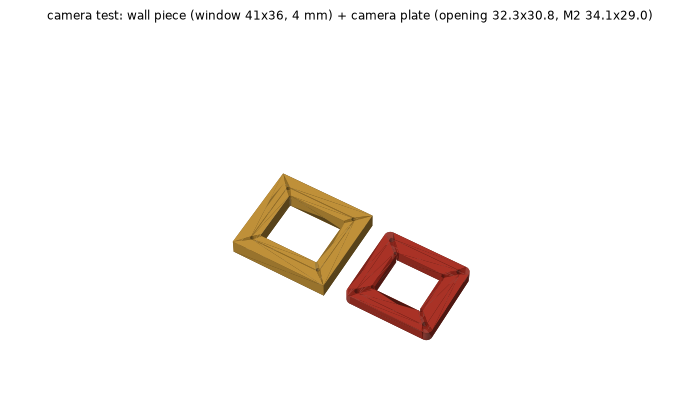

# SCOUT MINI sensor box (print version)

One-piece hexagonal box for the Bambu Lab A1, PLA, open top. One camera per face (6 cameras, 60° apart), with a Jetson AGX Orin inside. The original sheet-metal design is in [scout-mini-sensor-box](https://github.com/hwkim3330/scout-mini-sensor-box) (REV9), and its panel-assembled print version is in that repo's `rev10p/`.

3D: [v3/assembly.stl](v3/assembly.stl) · Source: [box.py](box.py) (all dimensions at the top; `VERSION` sets the output folder)

## Versions (one-piece body)

| Version | What changed | Body print | 3D |
|---|---|---|---|
| [v0-compare](v0-compare/) | Plain cups to compare shapes: round Ø245 vs hexagon (2.4 mm wall, windows only) | round 6 h 55 m / 395 g, hex 5 h 12 m / 329 g | [round](v0-compare/round.stl) · [hex](v0-compare/hex.stl) |
| [v1](v1/) | Hexagon with everything: 2.8 mm walls, corner columns, 45° floor fillet and top lip, camera pads, vents, floor holes | 9 h 02 m / 371 g (0.2 mm) | [body](v1/body.stl) |
| [v2](v2/) | 2.5 mm walls (exactly 6 lines, no gap fill), smaller columns, 0.24 mm layers | 8 h 02 m / 360 g | [body](v2/body.stl) · [assembly](v2/assembly.stl) |
| **[v3](v3/)** (current) | Camera test fit the real camera; camera plate opening made square | body same as v2 | [body](v3/body.stl) · [camera plate](v3/cam_plate.stl) · [assembly](v3/assembly.stl) |

Open issue: the camera plate's M2 holes (34.1 × 29.0, inferred from a caliper reading) sit 0.1 mm outside the clear housing, so they cut into the opening as notches. Waiting for measured hole positions.

## Print

| File | Part | Settings | Time | PLA |
|---|---|---|---|---|
| `v3/body.gcode.3mf` | Body (one piece) | 0.24 mm layers, 3 walls | **about 8 h** | 360 g |
| `v3/cam_plates_x6.gcode.3mf` | Camera plates ×6 | 0.2 mm | 1 h 07 m | 36 g |
| `v3/rail_bars_x2.gcode.3mf` | Rail bars ×2 | 0.2 mm | 1 h 20 m | 59 g |

- **Before the body:** run `v3/cam_test.gcode.3mf` (25 minutes, 14 g). It prints **two pieces**:
  - a **piece of wall** (66 × 61 × 4) cut out around the window, the same thickness as the body's camera pad
  - **one camera plate**

  Fit the real camera into them to check the red holder in the window, the clear housing through the plate, and the 4 M2 screws. If it fits, the body and the 6 plates will too. Wash the plate before the 8-hour print.

  
- **Rail bars:** print them after the robot arrives and the rail spacing is measured. The body doesn't depend on the rails. The bars bolt to it with M4 through fixed holes in the floor.

## Body design

- **Size:** 240 mm across corners (fits the 256 mm bed), 208 mm across flats, 130 mm tall. The AGX (110 × 110 × 72) fits inside, checked in code.
- **Walls 2.5 mm:** exactly 6 lines of 0.42 mm (3 per side), so the slicer has no slow gap fill to do.
- **Floor 3.2 mm:** with an M3 grid every 20 mm, the AGX holes (90 × 90), and M4 holes for the rail bars.
- **Strength, all of it printable without supports:**
  - Square columns in the six inside corners, with M3 pilot holes on top for a lid or lidar plate later.
  - A 45° fillet strip all round where the walls meet the floor.
  - A 45° lip around the inside of the top rim, which stiffens it and gives a lid something to sit on.
  - 4 mm pads inside around each camera window, so the M3 screws have material to bite.
  - A 0.5 mm chamfer on the first layer to prevent elephant foot.
- **Vents:** 7 slots low on each face for intake; the open top is the exhaust.

## Camera mounting (measured)

- **Red holder** (40.16 × 35.03 × 3.51) fits in the 41 × 36 wall window.
- **Clear housing** (31.74 × 30.25, 10.9 mm tall) goes out through the camera plate opening.
- **Screws:** M2 × 6 from outside, at 34.1 × 29.0 (a caliper reading of 31.90 × 26.8 plus a hole diameter of 2.2). **The camera test fit on the real camera (2026-10-27)**; mind which way the camera faces when fitting it. The plate opening has square corners.
- **Plate to body:** M3 self-tapping, 4 per camera.
- The code checks the camera dummies against the body and plates: no collisions.

## Screws

| Joint | Screw |
|---|---|
| Camera → plate | M2 × 6 (24) |
| Plate → body | M3 self-tapping (24) |
| Body ↔ rail bar | M4 + nut, the nuts sit in hex pockets in the bar (8) |
| Rail bar → robot rail | M5 + rail slider nut (4), rail spacing **HOLD** (slots take ±12 mm) |
