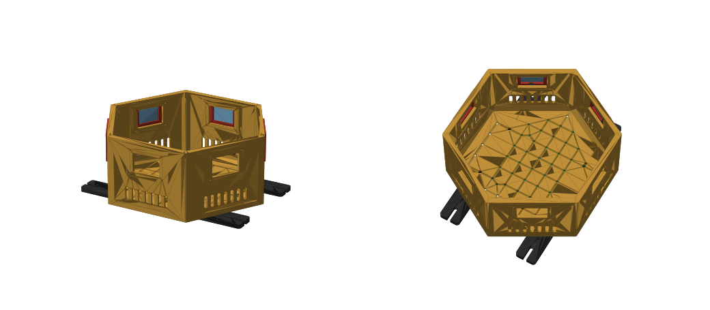

# SCOUT MINI sensor box (print version)

One-piece hexagonal box for the Bambu Lab A1, PLA, open top. One camera per face (6 cameras, 60° apart), with a Jetson AGX Orin inside. The original sheet-metal design is in [scout-mini-sensor-box](https://github.com/hwkim3330/scout-mini-sensor-box) (REV9), and its panel-assembled print version is in that repo's `rev10p/`.

3D: [v4/assembly.stl](v4/assembly.stl) · Source: [box.py](box.py) (all dimensions at the top; `VERSION` sets the output folder)

## Versions (one-piece body)

| Version | What changed | Body print | 3D |
|---|---|---|---|
| [v0-compare](v0-compare/) | Plain cups to compare shapes: round Ø245 vs hexagon (2.4 mm wall, windows only) | round 6 h 55 m / 395 g, hex 5 h 12 m / 329 g | [round](v0-compare/round.stl) · [hex](v0-compare/hex.stl) |
| [v1](v1/) | Hexagon with everything: 2.8 mm walls, corner columns, 45° floor fillet and top lip, camera pads, vents, floor holes | 9 h 02 m / 371 g (0.2 mm) | [body](v1/body.stl) |
| [v2](v2/) | 2.5 mm walls (exactly 6 lines, no gap fill), smaller columns, 0.24 mm layers | 8 h 02 m / 360 g | [body](v2/body.stl) · [assembly](v2/assembly.stl) |
| [v3](v3/) | Camera test fit the real camera; camera plate opening made square | body same as v2 | [body](v3/body.stl) · [camera plate](v3/cam_plate.stl) |
| [v4](v4/) | The clear housing is flush with the red holder's top edge (the cable is at the bottom), so the plate opening moves up 2.39 mm. The M2 holes stay symmetric on the red holder. Now the two lower holes are full circles; the two upper ones still touch the opening because they sit right beside the clear housing | body same as v2 | [camera plate](v4/cam_plate.stl) · [assembly](v4/assembly.stl) |
| **[v5](v5/)** (current) | **Simpler: no camera plates.** The camera mounts straight on the wall. The clear housing goes out through an opening in the wall, the red holder sits in a 1 mm pocket inside a 4 mm pad, and 4 × M2 × 6 go from outside into the red holder. That removes 6 plates and 24 M3 screws | 7 h 57 m / 365 g | [body](v5/body.stl) · [camera test](v5/cam_test.stl) · [assembly](v5/assembly.stl) |

Note: the M2 holes (34.1 × 29.0, symmetric on the red holder) sit right beside the clear housing. Since v4 only the upper two cut into the opening.

## Print (v5)

| File | Part | Time | PLA |
|---|---|---|---|
| `v5/cam_test.gcode.3mf` | Camera test: the wall's camera mount cut out as one small piece | 13 m | 7 g |
| `v5/body.gcode.3mf` | Body (one piece, 0.24 mm layers) | **about 8 h** | 365 g |
| `v5/rail_bars_x2.gcode.3mf` | Rail bars ×2 (after the robot arrives) | 1 h 20 m | 59 g |

- **Paper check (no printing):** print [v5/cam_template_A4.pdf](v5/cam_template_A4.pdf) on A4 at 100 % (actual size) and lay the camera on it to check the hole positions and opening. Check the 100 mm bar with a ruler first.
- **Camera test first:** fit the real camera into it. The clear housing goes out through the opening, the red holder drops into the pocket, and 4 × M2 go in from outside.
- **Body:** it takes about 8 hours, so start it in the morning and wash the bed plate first.
- **Rail bars:** print them after the robot arrives. The body doesn't depend on the rails.

## Body design

- **Size:** 240 mm across corners (fits the 256 mm bed), 208 mm across flats, 130 mm tall. The AGX (110 × 110 × 72) fits inside, checked in code.
- **Walls 2.5 mm:** exactly 6 lines of 0.42 mm (3 per side), so the slicer has no slow gap fill to do.
- **Floor 3.2 mm:** with an M3 grid every 20 mm, the AGX holes (90 × 90), and M4 holes for the rail bars.
- **Strength, all of it printable without supports:**
  - Square columns in the six inside corners, with M3 pilot holes on top for a lid or lidar plate later.
  - A 45° fillet strip all round where the walls meet the floor.
  - A 45° lip around the inside of the top rim, which stiffens it and gives a lid something to sit on.
  - 4 mm pads inside around each camera window, so the M3 screws have material to bite.
  - A 0.5 mm chamfer on the first layer to prevent elephant foot.
- **Vents:** 7 slots low on each face for intake; the open top is the exhaust.

## Camera mounting (measured, v5)

- **Red holder** (40.16 × 35.03 × 3.51) sits in a 1 mm pocket (41 × 36) on the inside of the wall. The wall is 4 mm thick there, and 3 mm at the opening.
- **Clear housing** (31.74 × 30.25, 10.9 tall) is flush with the red holder's top edge (the cable is at the bottom). It goes out through a 32.3 × 30.8 opening that sits 2.39 mm above centre, so about 7.9 mm shows outside.
- **Screws:** M2 × 6, four per camera, from outside through the wall into the red holder. Holes at 34.1 × 29.0, symmetric on the red holder.
- The code checks the camera dummies against the body: no collisions.

## Screws (v5)

| Joint | Screw | Qty |
|---|---|---|
| Camera → body | M2 × 6 (pan or button head) | 24 |
| Body ↔ rail bar | M4 × 12–16 + nut (the nuts sit in hex pockets in the bar) | 8 |
| Rail bar → robot rail | M5 + rail slider nut, rail spacing **HOLD** (slots take ±12 mm) | 4 |
| (Later) lid → corner columns | M3 self-tapping | 6 |
