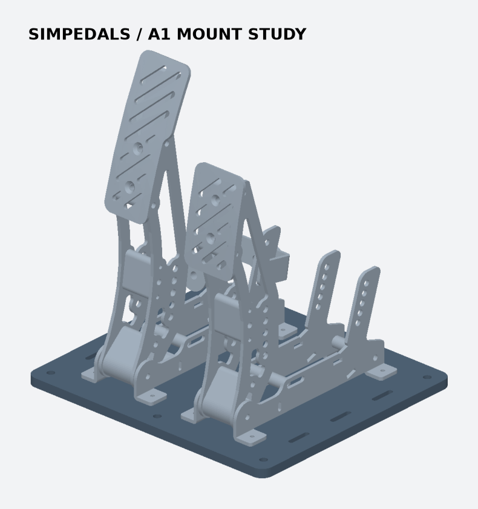

# SimPedals A1 장착판

[SimPedals](https://github.com/dmcke5/SimPedals)의 조립 STEP
[`a5598be`](https://github.com/dmcke5/SimPedals/tree/a5598be66d77a0f93598e20f3e6c94437ad59957)을 CadQuery로 열어 장착 홀을 추출했다.
원본 기구와 라이선스(CERN-OHL-S-2.0)는 upstream에서 제공한다.
이 폴더의 STL은 원본에 맞는 별도 장착판이며 원본 페달 STL이나 STEP을 포함하지 않는다.

- 각 페달의 네 장착 홀은 원본 기준 가로 59 × 앞뒤 150 mm, 원본 홀 Ø3.5 mm다.
- 원본 액셀과 가운데 브레이크 중심 간격 103 mm를 유지했다.
- 공용 데크는 246 × 218 × 8 mm, 통과 홀 Ø3.6 mm다. M3 관통 볼트·와셔로 조립하고 강성 있는 리그에 M6로 데크를 체결한다. 인쇄판의 하중 정격은 미확인이다.
- `59mm-foot-mount-coupon.stl`을 먼저 뽑아 원본 좌우 철판 한 쌍의 간격을 확인한다. `SimPedals-A1-Deck-PETG.gcode.3mf`는 데크 한 장이다.
- 바깥쪽 슬롯은 탈착형 가이드 후보 위치다. 와이어와 액추에이터까지 조립한 CAD 검증은 아직 없다.

## MG996R 와이어 적합성

와이어는 당길 때만 힘을 전달한다. 페달을 더 밟을수록 앵커와 고정 가이드 사이 길이가 줄어드는 위치에서 수동 개입이 가능하다. 풀어진 내선이 걸리지 않아야 하고 수동 분리 장치가 필요하다.

TowerPro MG996R의 6 V 정지토크 11 kgf·cm는 약 1.08 N·m다.
R15 드럼에서 손실을 무시한 정지점은 약 72 N이며 작동 하중 기준으로 사용하지 않는다.
반경을 줄이면 같은 토크에서 당김 힘이 커지지만 스트로크도 줄어든다.
예로 R15에서 52°의 감김은 13.6 mm다. 이는 이 SimPedals 조립의 실측 스트로크가 아니다.

먼저 수동 페달을 원본 부품으로 조립한다. 케이블 가이드 후보점과 앵커 사이에서 무부하부터 페달 전 구간의 거리와 요구 당김력을 측정한다. 액셀부터 검증한다. 브레이크는 스프링 또는 엘라스토머를 장착한 상태로 따로 측정하고, 감김 길이와 실측 구동력이 함께 맞을 때만 모터를 연결한다.

[MG996R 제조사 사양](https://towerpro.com.tw/product/mg996R/)
