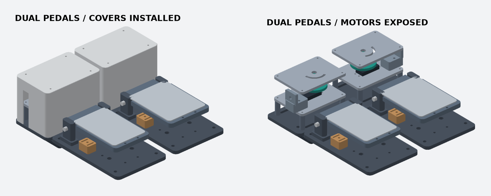

# Standalone Pedals V2 · 듀얼 MG996R

좌측 G2 브레이크, 우측 G1 액셀. 각 페달 뒤쪽에 MG996R, 6팔 혼 드럼, 회전 제한판, 배럴 어저스터를 배치했다. 좌우 포드를 대칭으로 설계해 보우든 외피가 발에서 떨어진 바깥쪽으로 나온다. CAD 조립 외형은 약 270 × 310 × 100 mm다. 바깥쪽 케이블 굽힘과 하부 외피 고정 공간은 이 치수에 더해야 한다.

## A1 출력

| 파일 | 설정 및 구성 |
|---|---|
| `axle-fit-coupon.stl` | 먼저 Ø8 축을 맞춰 볼 시험편. PLA로 출력 가능. |
| `pedals-v2-structure-petg.gcode.3mf` | A1 0.4 mm, PETG, 0.20 mm, 벽 4겹, 20% 인필. 페달과 모터 포드 구조부의 필요한 수량을 배치했다. |
| `pedals-v2-covers-petg.gcode.3mf` | A1 0.4 mm, PETG, 0.28 mm, 벽 3겹, 12% 인필. 탈착식 커버 2개를 윗면 아래로 눕혀 배치했다. |

커버 벽 2 mm, 지붕 2.4 mm. 두 커버 슬라이서 추정 7시간 57분 / 236 g. 구조부 4판 20시간 53분 / 574 g.

각 부품은 250 mm보다 작다. 구조판과 외장판을 분리해 두꺼운 레이어를 외장에만 적용했다. 출력 방향은 각 STL에 적용돼 있다. 실제 스풀 프로파일을 확인한다. 혼과 드럼은 [1번 혼용 어댑터 키트](../g923-horn/)를 각 1세트씩, 총 2세트 별도로 출력한다.

## 조립

1. 강성이 있는 공통 리그 판 위에 페달 베이스 2개와 모터 베이스 2개를 올린다. 각 페달-포드 사이에 스플라이스 2개를 밑으로 대고 M6 관통 볼트를 리그까지 고정한다. 스플라이스가 리그를 대신하지 않는다. 같은 높이가 되도록 나머지 리그 고정점에도 6 mm 금속 스페이서나 받침을 댄다.
2. 페달 축, 금속 발판, 스프링, 리미트 스트랩, 고무 스토퍼, Hall 포스트는 [독립형 페달 조립 안내](../standalone-pedals/)를 따른다. 스프링은 페달별로 선택하고 G1과 G2의 센서 간극을 따로 확인한다.
3. 각 모터 포드에 M3 스탠드오프, 서보판, 서보, 혼과 드럼을 쌓는다. 좌우 부품은 이름을 따라 조립한다. [모터 포드 적층과 하드웨어](../g923-drive/)를 참고한다.
4. 바깥쪽 어저스터에서 보우든 외피를 리그 하부의 고정 받침까지 매끄럽게 돌린다. 내선은 베이스 구멍을 지나 페달의 탈착 핀에 연결한다. 외피 끝은 양쪽에서 움직이지 않게 고정한다. 실물에서 발 공간과 외피 최소 굽힘 반경을 확인한 뒤 커버를 닫는다.
5. 수동 전환은 페달의 핀을 빼고 와이어 끝을 발 영역 밖에 고정한다. 전원 차단만으로 해제되는 구조는 아니다.

## 검증 범위

CadQuery의 단일 유효 솔리드 검사와 베드 크기를 통과했다. 좌우 모터 포드 각각의 커버·서보판·가이드·회전 제한판, 그리고 페달 베이스와 포드 베이스의 명목 간섭을 검사했다. 이전 페달과 동일한 힌지·케이블 기준 좌표를 사용한다. 조립 이미지의 서보·드럼·금속 발판은 배치용 형상이다. 케이블 굽힘, 금속 하드웨어 간극, 실제 발 하중, 브레이크 스프링의 자동 구동력, 센서 보정은 실물에서 검증해야 한다. 회전 제한판은 과부하 해제부를 대신하지 않는다.

`python model.py`로 개별 STL을 재생성한다. 저장소의 `standalone-pedals`와 `g923-drive` 모델 소스를 사용한다.
