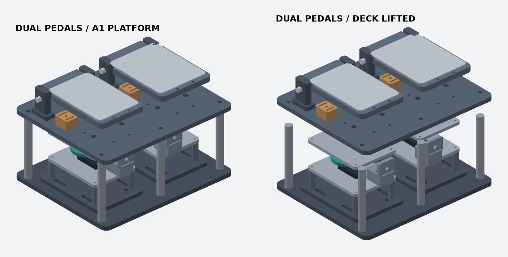

# Standalone Pedals V3 · A1 공용 데크

독립형 G2 브레이크(왼쪽)와 G1 액셀(오른쪽). 246 × 202 mm PETG 상판과 하판 사이에 두 MG996R 구동기를 놓는다. V2처럼 모터 박스가 페달 뒤로 튀어나오는 대신, 모터가 같은 바닥 면적 안에 들어간다. 상판 아래 스페이서 높이 104 mm는 기존 V2 모터 적층을 수용하는 값이다. 책상 또는 리그 기준 발 높이와 케이블 경로를 확인한다.

## 출력 순서

1. [기존 축 시험편](../standalone-pedals-v2/axle-fit-coupon.stl)과 [01 혼 어댑터](../g923-horn/)로 실물 맞춤을 확인한다.
2. `Pedal-V3-A1-Decks-PETG.gcode.3mf`는 **상·하판 각 한 장, 총 2판**이다. A1 0.4 mm, 0.20 mm, 4벽, 20% 인필. 폭 246 mm라 256 mm 베드 양쪽에 명목 5 mm씩 남는다. 프린터와 베드 프리셋을 확인한다.
3. `Pedal-V3-A1-Hardware-PETG.gcode.3mf`는 페달과 두 모터 포드 부품 3판이다. 혼·드럼 두 세트는 별도다. 상·하판까지 총 5판, 약 26시간 / 744 g이며 슬라이서에서 서포트 없이 배치됐다.
4. 선택 외장인 `Side-trim-x2.stl`은 두 개를 평평하게 출력한다. 금속 앵글 탭으로 옆면에 고정한다. 포드 내부 점검 시 옆판을 분리한다.

## 하드웨어와 조립

- 강성이 있는 리그에 하판을 고정한다. 상판은 **금속 관통 볼트와 압축 스페이서 6개**로 지지한다. 두 판 사이 명목 간격은 104 mm다. 플라스틱 기둥을 발 하중 받침으로 사용하지 않는다.
- 모터 포드는 하판의 M5 위치에 고정한다. 브레이크 포드를 좌측에서 -90°, 액셀 포드를 우측에서 +90°로 돌려 배치한다. 서보와 드럼 외형은 배치 확인용이다.
- 각 페달에는 Ø8 강철 축, 금속 발판, 복귀 스프링, 금속 고무범퍼 스토퍼를 사용한다. 하중 경로와 스토퍼 고정은 실물 하중으로 확인한다.
- 보우든 외피는 포드 어저스터에서 상판 중앙 개구 쪽으로 돌아가게 고정한다. 하부 고정 받침과 외피 곡률은 실물 피팅이 필요하다. 내선은 페달 퀵릴리스에 연결한다. G1/G2 신호, 두 위치 센서, 별도 서보 전원은 기존 설계를 따른다.

## 확인한 범위

CAD에서 좌우 포드끼리, 포드와 상판, 포드와 스페이서 6개의 명목 간섭을 검사했다. 페달의 힌지와 스토퍼 좌표는 기존 모델과 같다. 케이블 스윕, 실제 하중, 서보 구동 토크와 발 사용감은 실물 검증 전이다. `python model.py`로 STL과 간섭 검사를 재생성할 수 있다.
