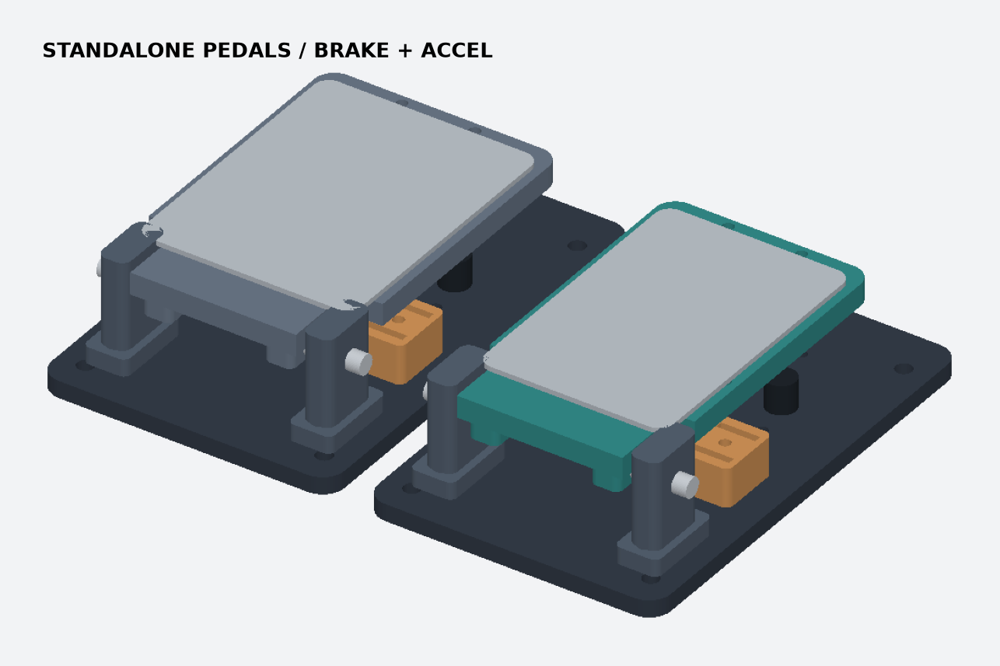

# Standalone Pedals · 독립형 액셀 / 브레이크

G923 부품 없이 조립하는 두 개의 페달이다. 왼쪽 브레이크는 폭 96 mm, 오른쪽 액셀은 폭 84 mm다. 각 베이스는 120 × 186 mm이며 두 베이스를 공통 리그 판에 고정한다. 시안은 베이스 중심 간격 134 mm다. 사용자의 신발과 다리 위치에 맞춰 간격을 조절한다.

## 출력 및 조립

1. PLA로 06 시험편을 출력해서 Ø8 mm 강철 축의 끼움과 회전을 확인한다. 필요하면 힌지와 페달의 Ø8.3 홀 파라미터를 보정한다. 나머지는 A1 0.4 mm, PETG, 0.2 mm, 벽 4겹 기준이다.
2. 베이스마다 M6 관통 볼트 4개로 리그 판에 체결한다. 힌지 두 개를 M5 관통 볼트 4개로 베이스와 리그에 고정한다. 양쪽 힌지와 페달 귀를 Ø8 mm 매끈한 강철 축으로 관통하고, 양끝에 샤프트 칼라를 둔다. 좌우 유격은 와셔로 조정한다.
3. 페달당 M5 관통 볼트 4개와 와셔로 금속 발판을 보강재 겸 트레드로 고정한다. 볼트 배열은 46 × 84 mm다. 렌더의 금속 판은 조립 참고용이다.
4. 베이스의 M8 자리 두 곳에 **고무 범퍼가 달린 강철 스토퍼**를 리그 판까지 관통해 고정한다. 양쪽 범퍼가 함께 닿게 조정한다. 12°일 때 명목 접촉면은 베이스 바닥에서 약 19 mm다. 눌림 하중은 스토퍼와 리그 판이 받는다.
5. y=78의 좌우 M4 자리에는 금속 가이드가 있는 복귀 스프링 두 개를 둔다. y=124의 두 고정점에는 상향 복귀 한계를 정하는 조절식 리미트 스트랩을 달고, 중립에서 두 스트랩 길이를 맞춘다. 스프링과 스트랩은 실물 선택품이다.
6. 각 페달 아래 자석을 기계적으로 고정하고, 05 포스트에 아날로그 Hall 센서를 둔다. 같은 축상에서 간극을 보정하고, 전체 스트로크에서 출력이 단조이며 자석과 센서가 닿지 않는지 확인한다. 센서와 자석은 모델에 포함되지 않는다.

## 서보 연결

중앙 y=65에 금속 아이와 빠지는 핀을 달고, 와이어를 베이스의 Ø12 개구 아래로 통과시킨다. 개구 아래에는 고정된 보우든 외피 받침과 리그 하부 여유가 필요하다. 기존 MG996R 드럼 구동기는 리그에 별도로 고정할 수 있다. 액셀은 G1, 브레이크는 G2다.

- 페달을 밟을수록 아이에서 하부 가이드까지 거리가 줄어든다. 내선은 당기는 방향으로만 작동하므로 사람이 서보 위치보다 더 밟으면 느슨해진다.
- 수동 사용 때는 핀을 빼고 와이어 끝을 발 영역 밖에 고정한다. 전원이 끊겨도 감긴 드럼이 자동으로 풀린다는 가정은 하지 않는다.
- 12° 예제에서 내선 이동량은 13.56 mm이고 R15 드럼에서 약 52°다. 액셀과 브레이크 복귀 스프링은 별도 선정한다. 서보가 감당할 수 있는 실제 케이블 힘과 과부하 해제부를 측정 전까지 확정하지 않는다.

## 검증 범위

CadQuery로 각각 유효 단일 솔리드와 베드 치수를 확인했다. 페달별 25개 자세에서 베이스·힌지·센서 포스트 간섭을 검사했다. 예제 와이어 경로는 101개 자세에서 길이가 단조 감소했다. 실제 재료 하중, 피로, 센서 응답, 스프링과 와이어를 달았을 때의 끼임과 해제는 미검증이다. 무부하 조립 시험 후 고정과 스토퍼를 확인하고, 정격을 정하기 전에 하중·반복 시험을 한다.

`python model.py`로 STL을 만들고 `python verify.py`로 명목 기하를 검사한다.
