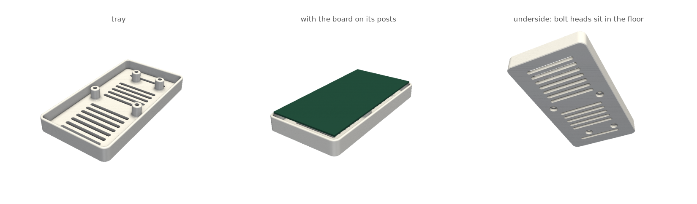

# TC4D7 Lite Kit 받침 (Infineon KIT_A3G_TC4D7_LITE)

[tray.py](tray.py). 뒷면에 핀이 있고 윗면에 실드(아두이노·mikroBUS·Shield2Go)를 꽂는 보드라 상자가 아니라 **열린 받침**이다.
바닥·낮은 벽·기둥 4개가 **한 몸**으로 나온다 — 보드를 12 mm 띄워 뒷면 핀·납땜이 닿지 않고, 벽은 보드 1 mm 아래에서 끝나
가장자리 커넥터(RJ45·CAN·USB-C·DC)를 막지 않는다.

- 보드 131 × 66 mm (사용 설명서 Table 2). 고정 구멍 4개는 모서리가 아니라 안쪽 — 설명서 그림에서 읽은 값(±0.5 mm):
  (60.5, 8.4), (111.8, 24.0), (59.5, 57.6), (111.9, 52.4) mm, 보드 왼쪽 위 기준(USB-C·DC 잭이 오른쪽).
  기둥은 못 움직이니 여유는 볼트에 둔다: 기둥 구멍 Ø4.2(M3 ±0.6 mm), 볼트 머리는 바닥 밑 Ø8 홈에 숨는다.
  실측이 더 다르면 `HOLES` 고치고 다시 생성.
- 조립: 바닥 밑에서 볼트 → 기둥 → 보드 → 위에서 너트(와셔). **M3 × 20 × 4 + 너트 4 + 와셔 4.**
- 모양: R6 모서리, 벽 윗면 완전 라운드, 기둥 뿌리 R2 필렛, 바닥 모서리 0.6 mm 모따기, 보드 밑 통풍 슬롯 13줄.
- 출력: `tray.gcode.3mf` PLA 한 판, 벽 3겹, 서포트·브림 없음 — **1 h 15 m / 38 g**. 139 × 74 × 16 mm.

## 파일

- `out/tray.stl` — 깃허브에서 바로 3D로 볼 수 있다
- `tray.gcode.3mf` — A1 PLA 한 판
